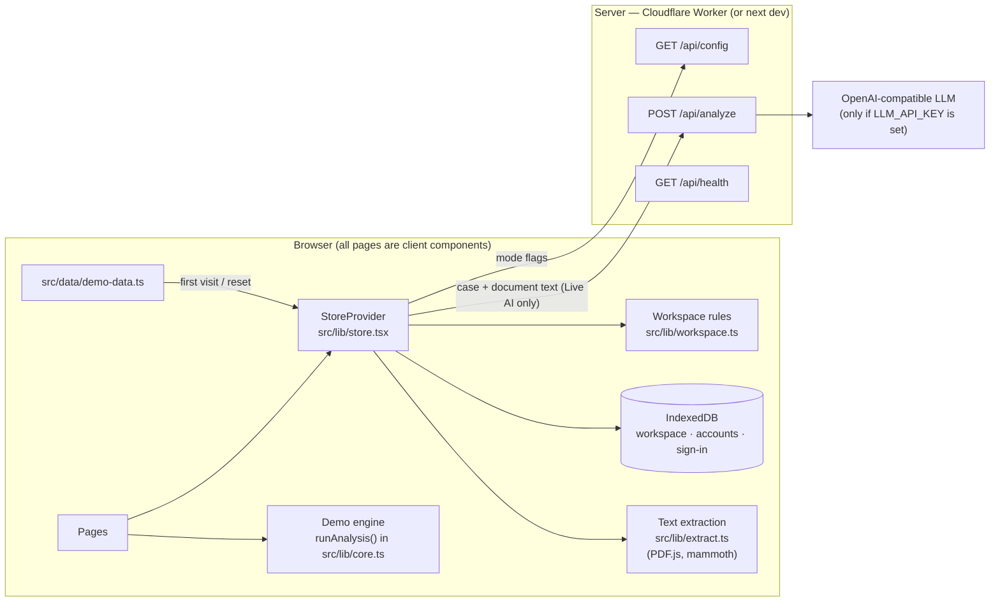

# CaseClarity AI — Project Context

> **What this file is:** the single place to understand what has been built, how the project is structured, which technologies it uses, what works, what is simulated, and what is left to do.
>
> **The code is the source of truth** — if this document and the code ever disagree, trust the code and update this document.

| | |
|---|---|
| **Product** | CaseClarity AI — explainable, human-in-the-loop AI case management for small legal-aid nonprofits |
| **Team · Event** | HACKSMITHS · Build for Campus 2026 |
| **Stage** | Hackathon prototype — **demo build**: no database, data saved in each visitor's browser, deployed on Cloudflare Workers |
| **Last reviewed** | 2026-11-21 |
| **Companion docs** | [README.md](./README.md) · [PROJECT_STATUS.md](./PROJECT_STATUS.md) · [PROBLEM_STATEMENT.md](./PROBLEM_STATEMENT.md) · [AGENTS.md](./AGENTS.md) |

## Contents

1. [Snapshot](#1-snapshot)
2. [Feature status](#2-feature-status)
3. [Tech stack](#3-tech-stack)
4. [Architecture](#4-architecture)
5. [Project structure](#5-project-structure)
6. [Data model and storage](#6-data-model-and-storage)
7. [API reference](#7-api-reference)
8. [Accounts & security](#8-accounts--security)
9. [AI analysis pipeline](#9-ai-analysis-pipeline)
10. [Pages](#10-pages)
11. [Demo data](#11-demo-data)
12. [Integrations](#12-integrations)
13. [Testing & validation](#13-testing--validation)
14. [Configuration & deployment](#14-configuration--deployment)
15. [What is simulated](#15-what-is-simulated)
16. [Known limitations](#16-known-limitations)
17. [Remaining work](#17-remaining-work)
18. [Development history](#18-development-history)

---

## 1. Snapshot

- **What it does:** turns long, inconsistent case documents into structured facts and an *explainable* recommendation — reasoning, evidence with document and page citations, a confidence indicator labelled as uncalibrated, missing information, uncertainties and next steps.
- **Core rule:** the AI never makes a final legal decision. Every recommendation waits for a human to approve, modify or reject it, and every action is written to an append-only audit trail.
- **Workflow (working end to end):** upload → text extraction (in the browser) → analysis → explainable recommendation → human review → audit trail.
- **Data:** there is **no database**. The fictional dataset lives in the repository (`src/data/demo-data.ts`). Each visitor's browser keeps its own copy in IndexedDB, so changes survive reloads, visitors never see each other's changes, and *Reset demo data* restores the original.
- **Demo accounts:** `demo@caseclarity.ai` (Senior Case Worker) and `caseworker@caseclarity.ai` (Case Worker), password `demo1234`, one click on the sign-in page. Sign-ups are stored in the browser with a bcrypt hash.
- **AI mode:** Demo Mode (deterministic engine, clearly labelled) unless `LLM_API_KEY` is configured on the server. Live AI has been verified end to end against a mock OpenAI-compatible provider (`tests/mock-openai-server.mjs`) with a scripted scenario run (`tests/e2e-live-ai.mjs`) — not yet with a real provider key. Every citation is verified server-side; contradictions must carry two traceable sides and unsupported ones are dropped.
- **Hosting:** Cloudflare Workers via vinext (Vite-based Next.js). `npm run dev` (Next.js) still works for local development.
- **The PostgreSQL version** (server-side sessions, bcrypt accounts on the server, persistent shared data) is preserved in git history at commit `34dd6c0`.

**Quality gates at last review (2026-11-21):** 85/85 Vitest tests · `npm run typecheck` ✓ · `npm run lint` ✓ · `npm run build` ✓ · `npm run build:cloudflare` ✓ · 12-scenario Live AI run against the mock provider passes (`tests/e2e-live-ai.mjs`) · scripted browser walkthrough (16 flows, desktop + 390 px mobile) passes on both `next dev` and the local Worker preview with zero console errors · `npm audit --omit=dev` → 0 vulnerabilities.

---

## 2. Feature status

**Legend:** ✅ working · 🟡 working, with documented limitations · 🧪 simulated, labelled as such in the UI · ⛔ not implemented.

| Area | Status | Notes |
|---|---|---|
| Landing page | ✅ | Hero, features, how it works, safety, about |
| Sign in / sign up / sign out | 🟡 | Browser-local accounts (bcrypt-hashed). Identifies who did what; **not** a security boundary (§8) |
| One-click demo accounts | ✅ | Senior Case Worker and Case Worker |
| Roles | ✅ | Case workers cannot delete cases or reset demo data |
| Dashboard | ✅ | Live counts, status chart, review queue, recent cases and activity |
| Cases: create, list, search, filter, detail, delete | ✅ | Case numbers `CC-<year>-NNN`; completeness from the required-documents checklist |
| Document upload with real text extraction | ✅ | PDF (real pages), DOCX, TXT, CSV, MD; 10 MB; extracted **in the browser** — files are never uploaded |
| Analysis — demo engine | 🟡 | Deterministic heuristics with per-document, per-page attribution |
| Analysis — Live AI | 🟡 | Server-side; facts, evidence and contradiction sides verified against the documents; structured contradictions; insufficient-evidence flag; tested against a mock provider only |
| Explainable recommendations | ✅ | All eight required elements (§9.6) |
| Human review | ✅ | Approve / modify / reject (locked after approve or reject), comment, request documents, flag |
| Audit trail | ✅ | Global and per case, search, category filter, CSV export; append-only |
| CSV import / export | ✅ | RFC 4180 (PapaParse), validation report, duplicate detection |
| Google Drive import | 🧪 | Labelled "Simulated"; no OAuth or Drive API |
| Evaluation page | 🧪 | Illustrative placeholder metrics, labelled; workspace totals are live |
| Persistence | 🟡 | Per browser (IndexedDB). No shared workspace across devices or people |
| Per-document summaries, OCR, organizations, password reset | ⛔ | See §17 |

---

## 3. Tech stack

| Layer | Technology | Version | Used for |
|---|---|---|---|
| Framework | Next.js (App Router) | 16.4.6 | Pages, route handlers, `npm run dev` / `npm run build` |
| Cloudflare build | vinext + Vite + `@cloudflare/vite-plugin` | 1.4.6 / 8.3.8 / 2.0.0-rc.3 | Builds and runs the same app on Cloudflare Workers (`*:cloudflare` scripts, `npm run deploy`) |
| Cloudflare CLI | `cf` (used by `@vinext/cloudflare`) | 1.0.0-rc.2 | Deploy and Worker configuration (`cloudflare.config.ts`) |
| UI | React / React DOM | 19.3.1 | Client components |
| Language | TypeScript (strict) | 5.9.3 | Entire codebase |
| Styling | Tailwind CSS v4 + `@tailwindcss/postcss` | 4.1.17 | Utility-first styling |
| Icons | lucide-react | ^1.73.0 | All icons |
| Browser storage | IndexedDB (no library) | — | Workspace, local accounts, sign-in (`src/lib/browser-db.ts`) |
| PDF extraction | unpdf (Mozilla PDF.js) | ^1.9.1 | Per-page PDF text, in the browser |
| DOCX extraction | mammoth (self-contained browser build) | ^1.13.0 | DOCX raw text, in the browser |
| CSV | papaparse | ^5.7.1 | RFC 4180 parsing and export |
| Password hashing | bcryptjs | ^3.0.3 | bcrypt (cost 10) for accounts created on the sign-up page |
| Tests | vitest | ^5.1.0 | Unit tests (`npm test`) |
| Linting | ESLint + eslint-config-next | 9.39.4 / 16.4.6 | `next/core-web-vitals` |
| LLM (optional) | Any OpenAI-compatible Chat Completions API | default `gpt-4o-mini` | `/api/analyze` |

Runtime: Node.js ≥ 22 for tooling. `package.json` has `"type": "module"` (required by vinext). `overrides.fflate = 0.7.5` patches a transitive advisory under vinext's OG-image support.

---

## 4. Architecture



### Key design decisions

1. **No server state.** All data operations happen in the browser through `useStore()`. The server has three stateless routes; with no LLM key, the only request the app makes is `GET /api/config`.
2. **Rules as pure functions.** `src/lib/workspace.ts` holds the rules the old API routes enforced — input validation and length limits, case numbering, review locking, append-only audit, cascade delete that keeps audit history — as pure functions returning a new workspace. `store.tsx` applies the result and saves it. They are unit-tested.
3. **Write-through persistence.** Each change saves the whole workspace to IndexedDB under the key `workspace`. IndexedDB runs transactions on one store in creation order, so the latest state wins. If storage is blocked (private window, disabled site data), the app keeps working in memory and shows one warning.
4. **Extraction in the browser.** PDF.js and mammoth load on first upload. Files never leave the device; in Demo Mode no document text leaves it either. An `import.meta.env?.SSR` guard lets the Cloudflare server build drop both parsers (Worker bundle ≈ 380 KB gzipped).
5. **Two analysis modes.** With a key, `/api/analyze` calls the LLM and verifies every citation against the text it was sent. Otherwise, or on any failure, the browser runs the deterministic engine. The mode is labelled in the UI, on each recommendation (`engine`) and in the audit trail.
6. **Page-preserving text.** Extracted pages are joined with a form feed (`\f`); the engine and the LLM prompt use it for page numbers.
7. **One codebase, two toolchains.** `next dev`/`next build` for local development; vinext builds the same `src/app` for Cloudflare Workers. `vinext check` reports 100 % compatibility.

### Start-up lifecycle

1. `StoreProvider` reads `workspace`, `accounts` and `session` from IndexedDB. A missing or unrecognised workspace (different `version`) is replaced by `demoWorkspace()`.
2. The saved sign-in (`session.userId`) is matched against the demo accounts and local accounts.
3. `ready` becomes true; the workspace layout then shows the app or "Sign in required".
4. In parallel, `GET /api/config` sets the AI mode label (Demo Mode if the request fails).

---

## 5. Project structure

```
.
├── cloudflare.config.ts        # Worker config: name, entrypoint, compatibility date/flags, (optional) secrets
├── vite.config.ts              # vinext + Cloudflare Vite plugin (Cloudflare build only)
├── next.config.ts              # Next.js config (defaults)
├── .env.example                # LLM_* for `npm run dev` (copy to .env)
├── .dev.vars.example           # LLM_* for the local Worker preview (copy to .dev.vars)
├── .github/workflows/ci.yml    # tests, typecheck, lint, Next build, Cloudflare build
├── tests/                      # Vitest (8 files, 56 tests)
└── src/
    ├── data/
    │   └── demo-data.ts        # THE DATASET: demo accounts + fictional cases, documents, facts, recommendations, audit
    ├── app/
    │   ├── layout.tsx          # root layout: metadata + <StoreProvider>
    │   ├── page.tsx            # landing page
    │   ├── login/ signup/      # sign-in (one-click demo accounts) and sign-up
    │   ├── (app)/              # workspace (route group): layout, dashboard, cases, cases/new,
    │   │                       #   cases/[id], upload, integrations, evaluation, audit
    │   └── api/
    │       ├── analyze/route.ts   # POST — Live AI (stateless) or a Demo Mode signal
    │       ├── config/route.ts    # GET — {aiMode, model}
    │       └── health/route.ts    # GET — {ok:true}
    ├── components/ui.tsx       # Card, Btn, Badge, StatusBadge, AiModeBanner, EngineBadge, …
    ├── types/                  # ambient types (mammoth browser build, import.meta.env)
    └── lib/
        ├── core.ts             # domain types, required-document checklist, demo engine, formatters
        ├── workspace.ts        # workspace rules (pure functions)
        ├── store.tsx           # React store: applies rules, saves to IndexedDB, calls /api/*
        ├── browser-db.ts       # tiny IndexedDB key-value wrapper (never throws)
        ├── accounts.ts         # demo + local accounts, sign-in, sign-up validation
        ├── password.ts         # bcrypt hash/verify
        ├── roles.ts            # roles and canManage()
        ├── extract.ts          # PDF/DOCX/TXT/CSV/MD text extraction (browser and Node)
        ├── csv.ts              # CSV parsing, mapping, dedupe, export
        ├── llm.ts              # prompt, provider call + output validation (citation checks)
        ├── validate.ts         # input sanitising helpers
        └── server-config.ts    # server only: LLM config, same-origin check
```

### Module boundaries

| Kind | Files | Rule |
|---|---|---|
| Shared (browser, server, tests) | `core.ts`, `csv.ts`, `llm.ts`, `validate.ts`, `workspace.ts`, `accounts.ts`, `password.ts`, `roles.ts`, `extract.ts`, `src/data/*` | No Node-only APIs (no `Buffer`, `fs`, `crypto` module) |
| Browser-only | `store.tsx`, `browser-db.ts`, `components/ui.tsx`, every page and layout | `"use client"` where React is involved |
| Server-only | `server-config.ts`, `src/app/api/**` | The only place that reads `process.env` |

---

## 6. Data model and storage

The TypeScript types in `src/lib/core.ts` are the schema. A `Workspace` (`src/lib/workspace.ts`) is:

| Field | Type | Order | Notes |
|---|---|---|---|
| `version` | number | — | `WORKSPACE_VERSION` (2). A saved workspace with another version is replaced by the demo data (v2 = structured contradictions + `insufficientEvidence`) |
| `cases` | `CaseItem[]` | newest first | id, caseNumber, title, clientName, caseType, status, priority, description, assignedTo, completeness (0–100), createdAt, updatedAt |
| `docs` | `DocItem[]` | newest first | id, caseId, name, type, size, status, extractedText (pages joined by `\f`), pageCount, source, uploadedAt. Only text is kept, never the file |
| `extractions` | `Extraction[]` | creation order | One fact with provenance: documentId, sourceDoc, sourcePage, sourceSnippet, confidence, category, `verified` |
| `recs` | `Recommendation[]` | newest first | title, summary, reasoning, confidence, status, engine (`seed`/`demo`/`llm`), evidence, contradictions (structured: field, description, ≥2 evidence sides with value/documentId/page/snippet), missingInfo, uncertainties, nextSteps, `insufficientEvidence`, reviewedBy/At, reviewComment |
| `audit` | `AuditEntry[]` | newest first | caseId (null for workspace events or deleted cases), actor, action, details, category, timestamp |

**IndexedDB** (database `caseclarity-ai`, store `kv`):

| Key | Value |
|---|---|
| `workspace` | the `Workspace` above |
| `accounts` | `LocalAccount[]` — id, name, email, org, role, `passwordHash` (bcrypt), createdAt |
| `session` | `{ userId }` of the signed-in account |

**Vocabularies:** case status `awaiting_review`, `in_progress`, `completed`, `missing_docs`, `flagged` · priority `low`, `medium`, `high`, `urgent` · recommendation status `pending`, `approved`, `rejected`, `modified` · audit category `case`, `document`, `ai`, `review`, `integration`, `system` (else `general`) · case types and their required documents in `REQUIRED_DOCS`.

**Rules enforced by `workspace.ts`:** titles and client names are required; strings are trimmed and length-limited; numbers are clamped; new recommendations always start `pending`; approved/rejected recommendations are locked; a modification needs replacement text and keeps the AI's evidence; deleting a case removes its documents, facts and recommendations, keeps its audit history (unlinked) and adds a "Case deleted" entry; CSV imports skip duplicates (client + title, case-insensitive) and count invalid rows.

---

## 7. API reference

Three stateless routes under `src/app/api/`. Nothing is stored on the server.

| Method and path | Request | Response |
|---|---|---|
| `GET /api/health` | — | `{"ok":true}` (liveness only — there is no database) |
| `GET /api/config` | — | `{"aiMode":"demo"\|"llm","model":string\|null}` — non-secret flags for honest labelling |
| `POST /api/analyze` | `{case:{title,clientName,caseType}, documents:[{id,name,extractedText}]}` | `{mode:"llm", model, result}` with verified citations and structured contradictions, or `{mode:"demo", reason}` (no key, LLM error, invalid JSON, timeout, unusable output). `403` cross-site, `413` too large (> 600,000 characters of text), `400` no documents |

`/api/analyze` rejects cross-site browser requests (Origin / Sec-Fetch-Site check in `isSameOrigin()`). The browser trims each document so the request never exceeds the prompt budget (`MAX_PROMPT_CHARS`, 60,000 characters).

---

## 8. Accounts & security

**What the demo build does**

- **Demo accounts** are defined in `src/data/demo-data.ts`; their password is public and shown on the sign-in page.
- **Sign-ups** are validated (email format, 8–200 character password, no duplicate email) and stored in this browser with a **bcrypt** hash (`src/lib/password.ts`, cost 10). The password itself is never stored.
- **Roles:** `case_worker` (sign-ups, Jordan Lee) cannot delete cases or reset demo data; `senior_case_worker` and `admin` can. The store refuses those actions for case workers, and the UI hides them.
- **Audit integrity:** the actor and reviewer always come from the signed-in user.
- **Privacy:** files never leave the device; only extracted text is kept, in the visitor's own browser. In Live AI mode the case's document text is sent to `/api/analyze` and on to the configured LLM provider for that one request.
- **Secrets:** `LLM_API_KEY` is read only on the server (`src/lib/server-config.ts`); nothing sensitive uses `NEXT_PUBLIC_*`.
- **CSRF:** `/api/analyze` blocks cross-site requests.

**What it does not do (by design for this build)**

- **Accounts are not a security boundary.** Everything lives in the visitor's browser; anyone with access to that browser profile can read its storage. Sign-in identifies who did what in the audit trail. It does not protect data.
- **No shared data:** each browser has its own workspace; there is no collaboration across devices or people.
- **Live AI is unauthenticated:** if `LLM_API_KEY` is set on a public deployment, anyone who can open the site can trigger LLM calls. Protect such a deployment with Cloudflare Access or a rate-limiting rule (§16).

The server-side model (sessions in an httpOnly cookie, bcrypt in PostgreSQL, rate-limited login, authenticated API) is in git history at `34dd6c0`.

---

## 9. AI analysis pipeline

### 9.1 Text extraction — `extractFile()` in `src/lib/extract.ts` (browser)

| File type | Library | Pages |
|---|---|---|
| PDF | unpdf (PDF.js), `mergePages: false` | Real per-page text joined with `\f` |
| DOCX | mammoth browser build | Text split into estimated pages (~1,800 characters, at paragraph boundaries) |
| TXT, CSV, MD | `TextDecoder` (UTF-8) | Same estimate |
| Other | — | "Unsupported file type" error |

Files over 10 MB are refused. A warning is shown when a PDF has no extractable text (scanned — no OCR). The case page then saves the document, recalculates completeness and writes a "Document uploaded" audit entry with page and character counts.

### 9.2 Running an analysis (`runAI` in `src/app/(app)/cases/[id]/page.tsx`)

1. Log "AI analysis started".
2. `analyze(caseId)` — in Demo Mode this returns `{mode:"demo"}` immediately, without a network call; with Live AI it posts the case's documents to `/api/analyze`.
3. `mode: "llm"` → map the verified facts and recommendation. Otherwise run `runAnalysis()` in the browser.
4. Replace the case's facts, add a new `pending` recommendation (older ones are kept; the newest is shown), update completeness and status (a completed case keeps its status), and log "AI analysis completed (LLM)" or "(Demo Mode)" with the reason for any fallback.

### 9.3 Live AI — `POST /api/analyze` + `src/lib/llm.ts`

- Calls `${LLM_BASE_URL}/chat/completions` with `LLM_MODEL`, `temperature: 0.2`, `response_format: json_object` and a configurable timeout (`LLM_TIMEOUT_MS`, default 90 s, clamped 5–300 s). The prompt marks `=== DOCUMENT: name ===` and `--- PAGE n ---` boundaries and is capped at 60,000 characters; the system prompt requires verbatim snippets, at least two cited sides per contradiction, an explicit `sufficientEvidence` flag and forbids stating legal decisions.
- `validateLlmResult()` verifies every fact, every evidence item and both sides of every contradiction against the text that was sent: unknown documents or quotes that do not appear are marked **Unverified** with confidence capped at 40, and wrong page numbers are corrected when the quote is found on another page. A contradiction with fewer than two verified sides is dropped rather than shown as a supported conflict. `sufficientEvidence: false` caps confidence at 60 and adds an uncertainty.
- Provider failures (timeout, 401/429/5xx, network), invalid JSON and unusable shapes all return `mode: "demo"` with a reason; the UI falls back to the demo engine and says so. The provider call itself is `postChatCompletion()` in `src/lib/llm.ts` (fetch-based, no SDK).

### 9.4 Demo engine — `runAnalysis()` in `src/lib/core.ts`

Deterministic, no network. Per page: dates (`Month D, YYYY`, `MM/DD/YYYY`, ISO) labelled by nearby words (deadline, effective date, date of birth…); money amounts labelled by the closest keyword (rent, income, arrears, bill, debt…), annualised when a period is given; the client name taken from the case; at most 6 dates and 6 amounts per page. Contradictions are checked only between comparable values: annual incomes that differ, different rents, and a "position eliminated" / "refilled" conflict. Each is returned as a structured contradiction with one evidence item per side (value, documentId, page, snippet), so both sides stay independently traceable. Missing documents come from the shared checklist (`checkRequiredDocs`). The recommendation is chosen in this order: 3 or more missing → request documents (90); contradictions → investigate (74); some missing → obtain remaining documents (80); otherwise proceed (86). `suggestStatus()` sets `missing_docs`, `flagged` or `awaiting_review`.

### 9.5 Attribution guarantees

Every fact keeps the real document id, filename, page and supporting snippet; evidence items always carry document, page ≥ 1 and snippet; every side of a contradiction carries its own document id, page and snippet. Covered by `tests/extraction.test.ts`, `tests/analysis.test.ts` and `tests/workflow.test.ts`.

### 9.6 Explainable recommendation display

Title and summary · why the AI generated it · supporting evidence · source document and page with the quote · confidence labelled "uncalibrated / heuristic only" · missing information · uncertainties · numbered next steps — plus engine, status, generation time, reviewer and comment, and an "Unverified" badge on any citation that could not be checked.

---

## 10. Pages

- **`/`** landing · **`/login`** form (prefilled with the demo account) plus one-click demo accounts · **`/signup`** name, email, password (≥ 8), organization.
- **Workspace shell** (`(app)/layout.tsx`): sidebar (Dashboard, Cases with live count, Upload Documents, Integrations, Evaluation, Audit Trail), New Case, user card with sign-out, *Reset demo data* (managers, two-click confirmation), top bar with search, AI-mode badge, review bell with the live pending count, toasts.
- **`/dashboard`** counts, status chart, Needs Your Review, recent cases and activity.
- **`/cases`** cards with completeness, search, status/type filters, CSV export · **`/cases/new`** create.
- **`/cases/[id]`** header actions (Run AI Analysis, Upload, Request Documents, Flag, Delete for managers with two-click confirmation) and tabs: Overview (checklist), Documents (upload, view/download text), Analysis (facts with sources), Recommendation (explanation + review panel), Human Review, Audit.
- **`/upload`** upload to any case · **`/integrations`** Google Drive (simulated), CSV import/export · **`/evaluation`** illustrative metrics + live totals · **`/audit`** global timeline, search, filter, CSV export.

---

## 11. Demo data

Defined in `src/data/demo-data.ts` and copied into the browser on first visit.

| Case | Client | Type | Status | Docs | Scenario | Sample recommendation (confidence) |
|---|---|---|---|---|---|---|
| CC-2026-001 | Maria Gonzalez | Housing / Eviction | awaiting_review | 6 | Complete documents — eviction after a medical emergency | Emergency stay + payment plan (88) |
| CC-2026-002 | James Carter | Benefits Appeal | missing_docs | 1 | Missing documents — SNAP denial | Request documents before filing (92) |
| CC-2026-003 | Aisha Thompson | Employment | flagged | 4 | Contradictions — $62,000 vs $69,600; "eliminated" role refilled | Investigate contradictions (74) |
| CC-2026-004 | David Okafor | Family Law | in_progress | 2 | Custody modification; financial disclosure pending | Draft petition after disclosure (71) |
| CC-2026-005 | Rosa Delgado | Consumer Debt | completed | 4 | Debt validation; creditor did not respond | Case closed (95, approved) |
| CC-2026-006 | Yusuf Hassan | Immigration | awaiting_review | 2 | Asylum support letter; sponsorship letter outstanding | Obtain sponsorship letter (79) |

Totals: 6 cases, 19 documents, 20 curated facts, 6 sample recommendations (engine `seed`, labelled "Sample data"), 14 audit events; 2 demo accounts. Running an analysis on a seeded case replaces its curated facts with engine output and adds a new recommendation that can differ — *Reset demo data* restores the originals.

To change the dataset, edit `src/data/demo-data.ts`; `tests/workspace.test.ts` checks that every reference points at an existing record. Visitors who already have a saved workspace keep it until they reset (or until `WORKSPACE_VERSION` changes).

---

## 12. Integrations

- **CSV import** (Integrations page): PapaParse; flexible column names (client/name, title/case, type/category, date/created, priority, status, description, assigned_to/assignee); warnings for missing columns, empty values and mixed date formats; dates, priority and status are imported; duplicates and invalid rows are counted in the report; an audit entry is written. A sample CSV can be downloaded.
- **CSV export:** cases and audit trail, RFC 4180 (`Papa.unparse`), audit-logged.
- **Google Drive (simulated):** five fictional files, a case picker, placeholder text, source "Google Drive (simulated)". No OAuth or Drive API.

---

## 13. Testing & validation

`npm test` — 10 files, 85 tests, no network or database needed:

| File | Covers |
|---|---|
| `workspace.test.ts` | Demo dataset integrity; saved-workspace loading; case numbering and validation; cascade delete keeping audit history; CSV import dedupe/invalid rows; pending-only new recommendations; review locking; modifications; fact replacement; audit actor/category |
| `accounts.test.ts` | Demo sign-in (case-insensitive email), wrong passwords, sign-up stores only a bcrypt hash, validation and duplicate emails |
| `extraction.test.ts` | Real PDF (generated) and DOCX (generated with jszip) extraction through the browser code path; fact attribution to document and page |
| `analysis.test.ts` | Required-document checklist; engine output on every seeded case; labelled amounts; contradiction rules |
| `llm.test.ts` | LLM output validation, citation checks, page correction, contradiction verification, insufficient evidence, prompt markers, provider-call failures (timeout, HTTP error, network, empty body) |
| `analyze-route.test.ts` | `POST /api/analyze` end to end: demo fallback without a key, 403/400/413, verified citations, unverified citation marking, HTTP 500/429, invalid JSON, rejected output, timeout, network failure |
| `workflow.test.ts` | The browser-side workflow through the store rules: analysis → facts with provenance → pending recommendation → human review locking → audit trail; demo-engine fallback |
| `auth.test.ts` | bcrypt hashing |
| `csv.test.ts`, `misc.test.ts` | CSV parsing/export details, roles, estimated pagination |

**Scripted Live AI run** (needs a running app and the mock provider):

```bash
node tests/mock-openai-server.mjs 4010     # mock OpenAI-compatible provider
cp tests/mock-llm.env.example .env         # point the app at it
npm run dev                                # terminal 2
node tests/e2e-live-ai.mjs                 # 12 scenarios, prints PASS/FAIL
```

**Validation sequence** (CI runs all of it on every push):

```bash
npm test
npm run typecheck          # next typegen + tsc
npm run lint
npm run build              # Next.js
npm run build:cloudflare   # Cloudflare Worker (vinext)
```

**Manual browser walkthrough (2026-11-21):** a scripted Playwright run covered one-click sign-in for both roles, all case tabs, approve → audit, create case, TXT + PDF + DOCX extraction in the browser, demo analysis, reload persistence, CSV import, all pages, 390 px mobile layout, role limits, sign-up/reload/wrong-password, and reset. It passed on `next dev` and on the local Worker preview. Live AI was checked against a mock OpenAI-compatible server on the Worker build, including verified and "Unverified" citations. These scripts are not in the repository yet (§17).

---

## 14. Configuration & deployment

| Variable | Where | Default | Purpose |
|---|---|---|---|
| `LLM_API_KEY` | `.env` (Next.js) / Worker secret / `.dev.vars` (Worker preview) | — | Enables Live AI |
| `LLM_BASE_URL` | same | `https://api.openai.com/v1` | OpenAI-compatible endpoint |
| `LLM_MODEL` | same | `gpt-4o-mini` | Model name |
| `LLM_TIMEOUT_MS` | same | `90000` | Provider request timeout in milliseconds (clamped 5000–300000) |
| `LLM_FALLBACK_MODELS` | same | `gemini-3.5-flash-lite` | Comma-separated models tried in order when the primary is unavailable |
| `LLM_MAX_ATTEMPTS` | same | `3` | Total provider attempts shared across the model chain (clamped 1–5) |
| `LLM_RETRY_BASE_DELAY_MS` | same | `1000` | Base delay for exponential backoff between attempts (clamped 0–30000) |

Any OpenAI-compatible Chat Completions endpoint works, including Google Gemini's compatibility endpoint (`LLM_BASE_URL=https://generativelanguage.googleapis.com/v1beta/openai/`, `LLM_MODEL=gemini-3.8-flash`) — it uses the same `Authorization: Bearer` header. Verified against the mock provider; a real Gemini call has not yet been completed from the development sandbox (its egress allowlist blocks `generativelanguage.googleapis.com`).

**Retries and model fallback.** `postChatCompletion` (`src/lib/llm.ts`) retries transient provider faults — HTTP 429, 500, 502, 503 and 504, plus timeouts and network errors — with exponential backoff and full jitter. The attempt budget (`LLM_MAX_ATTEMPTS`, default 3) is shared across the whole model chain, so a fallback can never turn one request into an unbounded one. When the primary model is still unavailable, each `LLM_FALLBACK_MODELS` entry is tried in turn (default `gemini-3.5-flash-lite`). A 404 skips to the next model instead of retrying an ID the provider will never resolve. **401/403 are never retried and never fall back** — every model uses the same key, so a rejected key cannot be worked around. If the whole chain is exhausted the route degrades to the labelled Demo Mode. A fallback result is a genuine LLM result and is labelled as such in the audit trail (`describeLlmModel`, `src/lib/core.ts`).

**Cloudflare** (`cloudflare.config.ts`): Worker `caseclarity-ai`, entrypoint `vinext/server/fetch-handler`, compatibility date 2026-11-20, flag `nodejs_compat` (exposes secrets on `process.env`), static assets binding. Live AI is enabled by the `bindings.secret()` lines — `LLM_API_KEY`, `LLM_BASE_URL`, `LLM_MODEL`, `LLM_TIMEOUT_MS` and `LLM_FALLBACK_MODELS` — set in the Cloudflare dashboard (Worker → Settings → Variables and Secrets) or by `.github/workflows/deploy-cloudflare.yml`, and in `.dev.vars` for local preview. `LLM_FALLBACK_MODELS` is optional: when it is unset the code default (`gemini-3.5-flash-lite`) applies. The timeout uses an explicit `AbortController` because `AbortSignal.timeout()` is ignored by the Worker runtime's `fetch`.

| Script | Does |
|---|---|
| `npm run dev` / `npm run build` / `npm start` | Next.js development / production build / server |
| `npm run dev:cloudflare` | vinext dev server (port 3001) with the Worker runtime |
| `npm run build:cloudflare` | Build the Worker into `.cloudflare/output/` |
| `npm run preview:cloudflare` | Run the built Worker locally in workerd |
| `npm run deploy` | Build and deploy to Cloudflare (`vinext-cloudflare deploy`; sign in first with `npx cf auth login`, or set `CLOUDFLARE_API_TOKEN` in CI) |

---

## 15. What is simulated

1. **Google Drive import** — fictional files and placeholder content; labelled.
2. **Demo Mode analysis** — deterministic heuristics; labelled everywhere.
3. **Confidence scores** — uncalibrated heuristics in both modes; labelled.
4. **Evaluation metrics** — illustrative placeholders; labelled.
5. **Demo data** — fictional cases, documents, facts, sample recommendations and audit history.
6. **Accounts** — real validation and hashing, but stored in the browser (§8).

---

## 16. Known limitations

- **Per-browser data** — no shared workspace; clearing site data, another browser or another device starts from the demo data. Two open tabs each save their own copy; the last change wins.
- **Accounts are not a security boundary** (§8).
- **Unprotected Live AI on public deployments** — anyone who can open the site can trigger LLM calls once a key is set. Use Cloudflare Access or a rate-limiting rule.
- **Live AI not yet tested with a real provider key** (verified against the mock provider in `tests/mock-openai-server.mjs`; the sandbox used for development has no outbound access to any LLM API).
- **Extraction gaps** — no OCR (scanned PDFs return no text), no legacy `.doc`, DOCX/TXT/CSV page numbers are estimated, original files are not kept.
- **Demo engine heuristics** are simple (§9.4); re-running analysis on a seeded case can differ from the sample recommendation.
- **Dataset updates** do not reach visitors who already have a saved workspace until they reset (or `WORKSPACE_VERSION` is bumped).
- **Toolchain** — vinext targets Next.js 16 but does not claim full parity; `@cloudflare/vite-plugin` 2.0 and `cf` are release candidates. vinext overwrites `.next/types/routes.d.ts`, so `npm run typecheck` regenerates Next's types first. Remaining `npm audit` findings are moderate and in dev-only lint tooling.

Earlier known issues KI-1 to KI-16 (completeness, ordering, CSV quoting, hardcoded counts, checklist matching, engine heuristics, LLM validation, labels, CSV import fields, Drive picker, security gaps, cascade deletes, minor UI items) were fixed on 2026-11-16; their descriptions are in git history.

---

## 17. Remaining work

**Before the final demo**

- [x] Merge the fixes into `main`; browser walkthrough (desktop + mobile).
- [x] Run without a database; deployable to Cloudflare Workers.
- [ ] Deploy: `npx cf auth login`, then `npm run deploy`, and open the `*.workers.dev` URL.
- [ ] Optional: enable Live AI with a real provider key (§14) and re-run the 12 scenarios in `tests/e2e-live-ai.mjs` against it; protect the deployment if you do.

**Product and AI quality**

- [ ] OCR for scanned PDFs; legacy `.doc`; real DOCX page boundaries; keeping original files.
- [ ] Per-document summaries; contradictions as first-class records; content-based document classification.

**Back end (when a shared, persistent workspace is needed again)**

- [ ] Bring back server-side storage and authentication — restore from `34dd6c0` (PostgreSQL), or move to Cloudflare D1 with the same rules (`src/lib/workspace.ts` is storage-agnostic).
- [ ] Organizations, password reset, admin screen for roles, audit immutability on the server.

**Integrations**

- [ ] Real Google Drive (OAuth 2.0 + Drive API); CSV column-mapping step.

**Testing and evaluation**

- [ ] Commit the Playwright walkthrough as automated end-to-end tests and run them in CI.
- [ ] Run the timed user study and extraction benchmark described on the Evaluation page and replace the placeholder metrics.

---

## 18. Development history

1. **Initial build** — complete UI, deterministic demo engine and fictional data; data and accounts in browser localStorage.
2. **Bug-fix pass** — CSV import counts, toasts instead of `alert()`, no duplicate facts on re-analysis, "Save Modification" requires text.
3. **Backend hardening** — real PDF/DOCX extraction, server-side LLM endpoint, per-page attribution, bcrypt with server sessions, PapaParse, PostgreSQL-backed API, 14 tests.
4. **Documentation** — `CONTEXT.md`, `AGENTS.md`, `PROBLEM_STATEMENT.md`.
5. **Repository setup** — `.gitignore`, git on `main`.
6. **Known-issues fix pass** — KI-1 to KI-16 (see §16), roles, rate limiting, origin checks, locked reviews, citation verification; 41 tests.
7. **Release pass** (2026-11-20) — Next.js 16.4.6 (security advisories), browser walkthrough with mobile and timezone fixes, CI; 46 tests. Last PostgreSQL version: `34dd6c0`.
8. **Demo build for Cloudflare** (2026-11-21) — PostgreSQL removed: the dataset lives in `src/data/demo-data.ts` and each browser keeps its own copy in IndexedDB; workspace rules moved to pure functions (`src/lib/workspace.ts`); browser-local accounts with bcrypt; one-click demo accounts for both roles; text extraction moved into the browser; `/api/analyze` made stateless; Cloudflare Workers deployment via vinext (React 19.3.1, `nodejs_compat`, opt-in secrets); production dependencies audit-clean; 56 tests.
9. **Live AI reliability pass** (2026-11-21) — contradictions became structured records with one traceable evidence item per side (demo engine, LLM validation and UI); added an explicit insufficient-evidence flag with confidence capping; strengthened the system prompt (verbatim snippets, ≥2 cited sides per contradiction, no legal conclusions); provider call extracted to `postChatCompletion()` with a configurable timeout and explicit 401/429/5xx/network handling; added route-level and workflow tests plus a mock provider (`tests/mock-openai-server.mjs`) and a 12-scenario scripted run (`tests/e2e-live-ai.mjs`); 85 tests.
