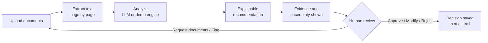
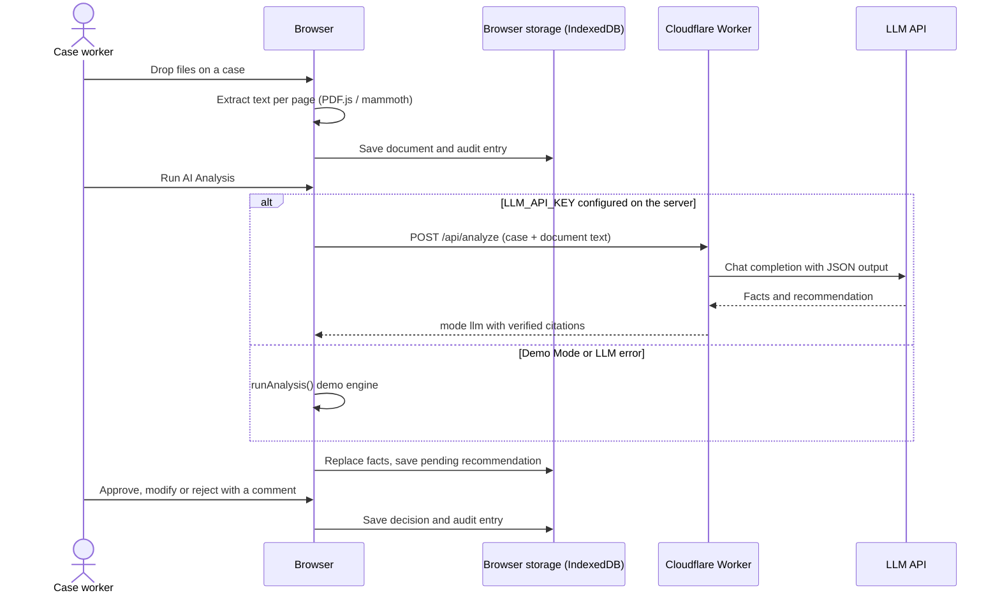

# Problem Statement — CaseClarity AI

> **Team:** HACKSMITHS · **Event:** Build for Campus 2026
>
> This document explains the original brief, the problem behind it, what we are building, our proposed solution and approach, the key features, and how the system works.
> For the verified implementation status see [CONTEXT.md](./CONTEXT.md); for development instructions see [AGENTS.md](./AGENTS.md).

---

## 1. The original problem statement

### 1.1 The brief in one paragraph

Build an **explainable AI-powered legal case management platform for small legal-aid nonprofits**. It must help case workers handle long, inconsistent legal documents and understand **why** an AI system produces a particular recommendation. The platform **must not make final legal decisions**: it assists human case workers by providing evidence-backed recommendations, confidence indicators, uncertainty warnings and an auditable decision history.

### 1.2 Required capabilities

| # | Area | What the brief asked for |
|---|---|---|
| A | Landing page | Logo and name; navigation (Home, Features, How It Works, About); the hero heading "Understand Every AI Decision. Trust Every Case."; a short product description; Get Started and Explore Features buttons; feature highlights; a how-it-works section; a professional footer |
| B | Authentication | Login and sign-up pages with email and password; a clean UI; a demo account for judges |
| C | Dashboard | Total cases, cases awaiting review, completed cases and cases with missing documents; recent case activity; case status charts; quick actions to create a case and upload documents |
| D | Document upload | PDF, DOCX and TXT; drag and drop; a list of uploaded files; processing status; text extraction; detection of missing or inconsistent information |
| E | AI document analysis | Summarize lengthy documents; extract important information (names, dates, income details, relevant facts); identify missing information; highlight contradictions between documents; show the source document and page for extracted facts |
| F | Explainable recommendations (**the most important feature**) | Every recommendation shows: the recommendation, why it was generated, supporting evidence, the source document and page, a confidence indicator, missing information, uncertainties and possible exceptions, and suggested next steps. Unsupported claims must never be presented as facts, and a confidence score must not be treated as a verified probability unless it has been calibrated and validated |
| G | Human review | Approve, reject or modify recommendations; add comments; request additional documents; mark cases for further investigation; record every human action |
| H | Audit trail | A detailed timeline of document uploads, AI analysis, extracted information, generated recommendations, supporting evidence, reviewer actions and changes to recommendations, with the date and time of every action |
| I | Integrations | At least two existing systems, without assuming clean APIs: Google Drive document import and CSV-based case-management import/export, handling missing columns, inconsistent date formats, incomplete records and duplicates. Without real credentials, workflows must still function and simulated integrations must be clearly labeled — never presented as live |

### 1.3 Cross-cutting requirements

- **Design:** a premium SaaS dashboard — white and very light grey backgrounds, deep navy as the primary color, soft blue accents, subtle shadows, rounded cards, modern typography and icons, smooth animations, fully responsive on desktop, tablet and mobile.
- **Technology:** React or Next.js, Tailwind CSS, a suitable backend (Python/FastAPI or an equivalent) for AI processing, an LLM API, and a database for cases and audit logs; modular, maintainable code.
- **AI safety:** never make final legal decisions; clearly distinguish facts from AI-generated interpretations; provide source evidence for every high-impact output; show uncertainty when information is incomplete; let human reviewers override recommendations; protect confidential client documents; use fictional sample data.
- **Demo data:** at least three fictional legal-aid cases — one with complete documents, one with missing documents and one with contradictory information — reflected in the analysis and recommendation screens.
- **Performance measurement:** compare manual and AI-assisted review time, information-extraction accuracy, missing-information detection and recommendation evidence coverage, using clearly labeled illustrative measurements that can later be replaced with real results.
- **Functionality:** the whole site must work — navigation, buttons, document upload, case creation and details, the analysis workflow, recommendation generation, human review actions, audit history, CSV import/export, search and filters — with a clearly labeled demo mode when no AI key is available.
- **Target workflow:** Upload documents → Extract information → Analyze documents → Generate an explainable recommendation → Display supporting evidence and uncertainty → Human review → Save the decision in the audit trail.

### 1.4 Engineering requirements added after the first review

A code review of the first version added stricter requirements: real PDF and DOCX text extraction; a real LLM integration through a secure backend; correct evidence attribution (every fact keeps its own document ID, filename, page number and supporting text); password hashing with server-side authentication; a standards-compliant CSV parser; Google Drive kept labeled as simulated until real OAuth and Drive API access exist; PostgreSQL instead of browser storage; authenticated and authorized API endpoints; automated tests for document extraction, evidence attribution, authentication and CSV imports; and no claims about features that do not actually work.

---

## 2. The problem we are solving

### 2.1 Who is affected

- **Case workers and paralegals** at small legal-aid nonprofits, who prepare and triage cases.
- **Supervising attorneys**, who need to check work quickly and trust what they sign off on.
- **Clients** — people facing eviction, benefit denials, employment disputes, custody changes, immigration proceedings or debt collection (the case types modeled in the prototype) — whose outcomes depend on accurate and timely case preparation.

### 2.2 Pain points

1. **Long, inconsistent documents.** A single case can include leases, notices, pay stubs, medical bills, letters and emails in different formats (PDF, Word, plain text, spreadsheets). The important facts are scattered and phrased differently in each one.
2. **Missing information.** Cases stall when a required document is missing, and legal deadlines — an appeal window, an eviction date — make every gap costly.
3. **Contradictions.** Documents disagree: the salary in a termination letter differs from the pay stub; a "position elimination" is followed by the position being refilled. Such conflicts are easy to miss in manual review and can decide a case.
4. **Black-box AI is not acceptable.** A recommendation without reasons and evidence cannot be verified. Generic AI tools can sound confident while being wrong, and an unexplained "confidence score" invites over-trust.
5. **Accountability.** Organizations must be able to show who decided what, when, and based on which evidence.
6. **Messy existing systems.** Case data often lives in spreadsheets, CSV exports from legacy case-management systems and shared drives — not clean APIs — with duplicates, missing columns and inconsistent date formats.
7. **Limited capacity.** Small nonprofits have few staff and tight budgets, so tools must be simple, quick to learn and inexpensive to run.

### 2.3 Why existing approaches fall short

| Approach | Gap |
|---|---|
| Manual document review | Slow and inconsistent with long files; gaps and contradictions are easy to miss |
| Generic AI chat tools | No document or page provenance, no structured output and no audit trail; guesses can be presented as facts; client data leaves the organization's control |
| Traditional case-management software | Stores documents but does not help staff understand them or explain recommendations |

---

## 3. What we are building

**CaseClarity AI** is a web application that combines case management with **explainable, evidence-backed AI assistance**, a **human-in-the-loop review workflow** and a **complete audit trail**.

> *The AI drafts. The evidence explains. A human decides. Everything is recorded.*

It is a working full-stack prototype built for the hackathon, and it uses fictional data only.

---

## 4. Proposed solution — design principles

| Principle | What it means in CaseClarity AI |
|---|---|
| Explainability by default | Every recommendation shows its reasoning, evidence, missing information, uncertainties and next steps |
| Evidence attribution | Every extracted fact carries its source document, page number and a quoted snippet |
| Human-in-the-loop | Recommendations start as `pending`; only a person can approve, modify or reject them |
| Honest uncertainty | Confidence is labeled as an uncalibrated heuristic; gaps and caveats are shown, not hidden |
| Full auditability | Uploads, analyses, recommendations and review actions are stored with the actor and a timestamp |
| Works with messy reality | A tolerant CSV import with a visible validation report; the Drive import is clearly marked as simulated |
| Privacy and safety by design | Fictional data; documents are read in the browser and never uploaded; only extracted text is kept; server-side secrets; hashed passwords |
| Graceful degradation | Without an LLM key, a transparent deterministic demo engine keeps the whole workflow usable — and is labeled as such |

---

## 5. Our approach

### 5.1 Product approach

- **Workflow first:** build the brief's end-to-end flow, then make every screen and button functional.
- **Explainability as the centerpiece:** the recommendation screen is designed around the eight required elements.
- **Scenario-driven demo:** fictional cases chosen to show complete, missing and contradictory evidence.
- **Professional UI:** a navy-and-blue SaaS design that feels like a real product and adapts to any screen size.

### 5.2 Technical approach

- **One TypeScript codebase on the Next.js App Router**, deployed to **Cloudflare Workers** through vinext. Route Handlers act as the backend — the brief allowed an equivalent to Python/FastAPI — and serve the LLM proxy.
- **Demo build without a database (current).** The fictional dataset ships in the repository (`src/data/demo-data.ts`); each visitor's browser keeps its own copy in IndexedDB. The rules a backend enforces — validation, case numbering, locked reviews, append-only audit — are pure, unit-tested functions (`src/lib/workspace.ts`). An earlier version used **PostgreSQL with Drizzle ORM** and server-side sessions; it is preserved in git history (commit `34dd6c0`) for when a shared workspace is needed.
- **Document extraction in the browser:** PDF.js (through `unpdf`) reads PDFs page by page so facts can cite pages, and `mammoth` reads DOCX files. Files never leave the device.
- **Dual-mode analysis:** an OpenAI-compatible LLM called from the server with a structured-JSON prompt that requires citations (every citation is verified against the documents), or — when no key is configured — a deterministic, rule-based demo engine with per-document, per-page attribution.
- **An explainable recommendation data model:** title, summary, reasoning, confidence, evidence (claim, document, page, snippet), missing information, uncertainties, next steps, status, reviewer and review comment.
- **Security basics for a demo build:** secrets only on the server, cross-site requests blocked, bcrypt-hashed passwords for new accounts, role checks. Accounts are browser-local, so they identify users rather than protect data — the trade-off is documented in CONTEXT.md §8.
- **Integration without clean APIs:** RFC 4180 CSV parsing (PapaParse) with validation and duplicate reporting, plus a clearly labeled Google Drive simulation.
- **Measurable claims:** an evaluation page with illustrative, clearly labeled metrics and a documented method for replacing them with real results.
- **Quality:** automated tests for the data rules, accounts, document extraction, evidence attribution, LLM citation checks and CSV import, run in CI together with both builds.

---

## 6. Key features

Status uses the CONTEXT.md legend: ✅ working · 🟡 working with documented limitations · 🧪 simulated (labeled in the UI) · ⛔ not yet implemented.

| Brief | Feature | Status |
|---|---|---|
| A | Landing page with hero, features, how it works, safety, about and footer | ✅ |
| B | Email/password sign-up and sign-in; one-click demo accounts for judges (two roles) | ✅ 🟡 browser-local accounts |
| C | Dashboard: case counts, status chart, review queue, recent activity, quick actions | ✅ |
| D | Drag-and-drop upload; real text extraction for PDF, DOCX and TXT (plus CSV and MD); processing status | ✅ |
| E | Fact extraction with document, page and snippet; missing-document and contradiction detection | 🟡 demo-engine heuristics; LLM mode verified against a mock LLM, not yet with a live key |
| E | Per-document summaries | ⛔ |
| F | Explainable recommendation with all eight elements and uncalibrated-confidence labeling | ✅ |
| G | Approve, modify, reject, comment, request documents, flag for investigation — all recorded | ✅ |
| H | Global and per-case audit timelines with search, filters and CSV export | ✅ |
| I | CSV import/export with a validation report and dedupe | ✅ |
| I | Google Drive import | 🧪 |
| — | Evaluation page with illustrative metrics | 🟡 illustrative |
| — | Search and filters (cases, audit trail) | ✅ |

Details of every limitation are listed in CONTEXT.md §16. In this demo build, data is saved per browser rather than in a shared database.

---

## 7. How the system works

### 7.1 End-to-end workflow

### 7.2 Step by step

1. **Upload.** A case worker opens a case (or the Upload page) and drags in PDF, DOCX, TXT, CSV or MD files of up to 10 MB each.
2. **Extract.** The browser extracts the text — PDFs page by page — and reports the page count and any warning (for example, a scanned PDF without a text layer). The text is saved with the document and a "Document uploaded" event is written to the audit trail. The file itself is not uploaded or kept.
3. **Analyze.** With an LLM key, "Run AI Analysis" sends the case's document text to the server, and the model returns structured JSON with cited facts and a recommendation, each citation checked against the documents. Otherwise the deterministic demo engine runs in the browser. → `POST /api/analyze` (Live AI only)
4. **Recommend.** The extracted facts replace the case's previous facts and a new `pending` recommendation is saved. The Analysis tab lists every fact with its document, page, confidence and quoted snippet.
5. **Explain.** The Recommendation tab shows the recommendation, why it was generated, the supporting evidence with document and page, the confidence (labeled uncalibrated), missing information, uncertainties and next steps.
6. **Review.** The case worker approves (the case becomes `completed`), modifies (new text plus a comment), rejects, requests more documents or flags the case for investigation. Approved and rejected recommendations are locked.
7. **Audit.** Every step above is stored with its actor, category and timestamp, and appears on the case's Audit tab and in the global Audit Trail, which can be searched, filtered and exported as CSV.

### 7.3 Anatomy of an explainable recommendation (seeded example)

Case **CC-2026-003 — Aisha Thompson, wrongful termination (contradictory information):**

| Element | Content |
|---|---|
| Recommendation | Recommend: Investigate Contradictions Before Filing |
| Why the AI generated it | The accommodation request (Feb 18) precedes the termination (Apr 10) by about seven weeks, and the "eliminated" position was refilled on Apr 15. However, the salary figures conflict: $62,000 in the termination letter vs $69,600 on the March 2026 pay stub |
| Supporting evidence | Accommodation_Request_Email.txt, p. 1 — "dated February 18, 2026" · Termination_Letter_Thompson.pdf, p. 1 — "Effective date: April 10, 2026…" · Accommodation_Request_Email.txt, p. 1 — "position was refilled April 15, 2026" · Pay_Stub_Thompson_Mar.pdf, p. 1 — "Gross $5,800/month ($69,600/year)" |
| Confidence | 74% — moderate; an uncalibrated heuristic |
| Missing information | HR raise memo confirming the January 2026 salary increase · job posting for the refilled position |
| Uncertainties and exceptions | Whether the salary gap is a clerical error or an intentional misstatement is unclear · the employer may claim an independent reason for the termination |
| Suggested next steps | Request the HR raise memo from the client · preserve the email headers of the accommodation request · consult an employment attorney before the filing deadline |
| Human decision | Pending — waiting for a case worker to approve, modify or reject |

### 7.4 Two analysis modes

| | LLM mode | Demo Mode (current environment) |
|---|---|---|
| When it is used | `LLM_API_KEY` is set on the server (a Worker secret on Cloudflare) | No key, or the LLM call fails |
| Where it runs | Server → OpenAI-compatible API | In the browser; deterministic |
| How facts are found | The model returns facts with source document, page and snippet | Rules for names, dates and dollar amounts, attributed per document and page |
| Status | Implemented; verified against a mock LLM, not yet with a live key | Working; heuristic (CONTEXT.md §9.4) |

---

## 8. Demo scenarios (fictional)

| Case | Scenario | What it demonstrates |
|---|---|---|
| CC-2026-001 · Maria Gonzalez · Eviction | Complete documentation: lease, eviction notice, pay stubs, medical bill, payment history | A well-supported recommendation with four cited evidence items |
| CC-2026-002 · James Carter · SNAP appeal | Only the denial letter is on file | Missing-information handling: "don't file yet — gather income verification first", with the appeal deadline |
| CC-2026-003 · Aisha Thompson · Employment | Salary figures and the timeline conflict across documents | Contradiction handling and moderate confidence |
| CC-2026-004 · David Okafor · Family law | Financial disclosure still pending | Partial evidence |
| CC-2026-005 · Rosa Delgado · Consumer debt | Closed; recommendation approved | A completed human review |
| CC-2026-006 · Yusuf Hassan · Immigration | Sponsorship letter outstanding | An urgent case with outstanding documents |

All names, documents and events are invented.

---

## 9. Responsible AI commitments

| Commitment | How it is implemented |
|---|---|
| No final legal decisions | Recommendations are created as `pending`; only human actions change their status |
| Facts vs AI interpretation | Facts are shown with document, page and snippet; recommendations are labeled "AI Recommendation" and come with reasoning and uncertainties |
| Evidence for high-impact outputs | Each recommendation lists evidence items with source document and page; with no evidence, the UI warns "treat this recommendation with extra caution" |
| Uncertainty is visible | Missing information and uncertainties are part of every recommendation; demo-mode uncertainties state that the confidence is uncalibrated |
| Human override | Approve, modify or reject with comments; document requests and flags are recorded |
| No false precision | The recommendation screen labels confidence "Confidence (uncalibrated)" and "heuristic only", and audit entries say "uncalibrated" (the dashboard queue shows the bare percentage) |
| No fake integrations | Google Drive is labeled "Simulated"; Demo Mode banners are shown; evaluation metrics are labeled illustrative |
| Protect confidential data | Fictional data only; documents read in the browser and never uploaded; original files are not stored; server-side keys; bcrypt password hashes |

---

## 10. Measuring success

The metrics requested by the brief are currently shown with **illustrative placeholder values** (`EVALUATION` in `src/lib/core.ts`):

| Metric | Manual | AI-assisted | Note |
|---|---|---|---|
| Review time per case | 95 min | 22 min | AI-assisted = human verifies and approves |
| Extraction accuracy | 88% | 91% | Field-level match on the demo set |
| Missing-information detection | 72% | 96% | Recall on the required-document checklist |
| Evidence coverage | 64% | 89% | Share of claims with a source citation |

**These are not measured results.** The plan for replacing them (also described on the Evaluation page):

1. **Timed user study** — 5–10 case workers review the same fictional cases manually and with AI assistance; record the time per case.
2. **Extraction benchmark** — score extracted fields against a gold-standard annotation of the demo documents; report precision and recall per field type.
3. **Evidence-coverage audit** — reviewers rate whether each recommendation claim has an adequate source citation; report the percentage with inter-rater agreement.

---

## 11. Scope, assumptions and non-goals

- **In scope:** the end-to-end workflow, explainable recommendations, human review, the audit trail, CSV integration, a simulated Drive integration, the evaluation framework and fictional demo data.
- **Assumptions:** case workers verify AI output against the original documents; an LLM key is optional; in the demo build each browser holds its own workspace.
- **Non-goals for this prototype:** giving legal advice or making legal decisions; court e-filing; a client-facing portal; processing real client data; production-grade compliance (see the security roadmap in CONTEXT.md §17).

---

## 12. Current status

The full workflow works end to end in the **demo build**: no database (the fictional dataset ships with the app and each visitor's browser keeps its own copy), real document extraction in the browser, browser-local accounts with two roles, and 56 passing automated tests. It deploys to Cloudflare Workers. Analysis runs in Demo Mode unless an LLM key is configured. The engineering review's "PostgreSQL instead of browser storage" and server-side authentication requirements were met in an earlier version (git commit `34dd6c0`) and deliberately set aside for this zero-infrastructure demo; bringing them back is on the roadmap. Limitations and the roadmap are in [CONTEXT.md §16–17](./CONTEXT.md#16-known-limitations).
