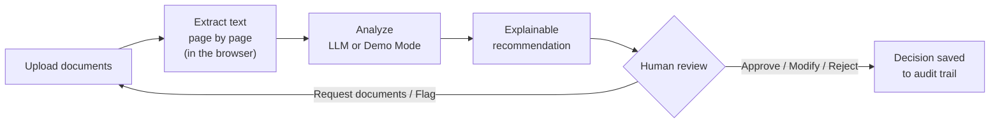
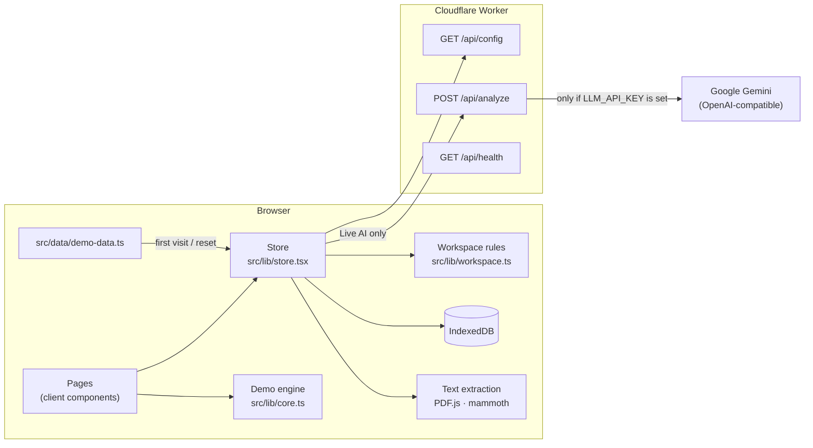

<div align="center">

# CaseClarity AI

**Understand Every AI Decision. Trust Every Case.**

Evidence-backed, human-reviewed AI assistance for legal-aid case management.

A Build for Campus 2026 project by **Team HACKSMITHS**


</div>

CaseClarity AI helps case workers at small legal-aid nonprofits turn long, inconsistent case documents into source-cited facts and **explainable recommendations** — while a human stays in charge of every decision. Each recommendation shows *why* it was made, the evidence behind it with document and page references, a confidence indicator clearly labelled as an uncalibrated heuristic, what information is missing, what is uncertain, and what to do next. Every upload, analysis and review action is written to an audit trail.

> **The AI assists. Humans decide.** CaseClarity AI never makes final legal decisions. All demo data is fictional, and nothing in this project is legal advice.

**Demo login:** one click on the sign-in page, or `demo@caseclarity.ai` / `demo1234` (Senior Case Worker) and `caseworker@caseclarity.ai` / `demo1234` (Case Worker).

> **Demo build — no database.** The fictional dataset lives in this repository ([`src/data/demo-data.ts`](./src/data/demo-data.ts)). Each visitor's browser keeps its own copy, so every judge gets a private, persistent sandbox; *Reset demo data* restores the original. The earlier PostgreSQL version (server-side sessions and storage) is in git history at commit `34dd6c0`.

---

## Contents

- [The problem](#the-problem)
- [Our solution](#our-solution)
- [How it works](#how-it-works)
- [Key features](#key-features)
- [What is real and what is simulated](#what-is-real-and-what-is-simulated)
- [Quick start](#quick-start)
- [Deploying to Cloudflare](#deploying-to-cloudflare)
- [Demo guide for judges](#demo-guide-for-judges)
- [Tech stack](#tech-stack)
- [Architecture](#architecture)
- [Project structure](#project-structure)
- [Configuration](#configuration)
- [Scripts](#scripts)
- [Tests and quality checks](#tests-and-quality-checks)
- [API overview](#api-overview)
- [Responsible AI and privacy](#responsible-ai-and-privacy)
- [Known limitations](#known-limitations)
- [Documentation](#documentation)
- [Team](#team)
- [License and disclaimer](#license-and-disclaimer)

---

## The problem

Small legal-aid nonprofits help people facing eviction, benefit denials, employment disputes and other urgent legal problems — usually with few staff and hard deadlines. Their case workers deal with:

- **Long, inconsistent documents.** Leases, notices, pay stubs, letters and emails arrive in different formats, and the important facts are scattered across them.
- **Missing information.** A case stalls when a required document is absent, and deadlines make every gap costly.
- **Contradictions.** Figures and dates that disagree between documents are easy to miss in manual review.
- **Untrustworthy AI.** A recommendation without reasons or evidence cannot be verified, and an unexplained "confidence score" invites over-trust.
- **Accountability.** Teams must be able to show who decided what, when, and based on which evidence.
- **Messy existing systems.** Case data often lives in spreadsheets, CSV exports and shared drives rather than clean APIs.

## Our solution

| Principle | How CaseClarity AI applies it |
|---|---|
| Explainability by default | Every recommendation shows its reasoning, evidence, missing information, uncertainties and next steps |
| Evidence attribution | Every extracted fact keeps its source document, page number and a quoted snippet |
| Human in the loop | Recommendations start as *pending*; only a case worker can approve, modify or reject them |
| Honest uncertainty | Confidence is labelled as an uncalibrated heuristic; gaps and caveats are shown, not hidden |
| Full auditability | Uploads, analyses, recommendations and review actions are recorded with the actor and a timestamp |
| Works with messy data | A tolerant CSV import that reports problems instead of silently dropping them |
| Graceful degradation | Without an LLM API key, a transparent, deterministic Demo Mode keeps the whole workflow usable |
| Privacy by design | Documents are read in the browser — files are never uploaded to a server |

### Our approach

- **One TypeScript codebase on Next.js (App Router).** Every page is a React client component; three small route handlers form the server.
- **Zero-infrastructure demo build.** No database: the dataset ships with the app and each browser keeps its own copy in IndexedDB. The rules a backend would enforce — validation, case numbering, locked reviews, an append-only audit trail — live in pure, unit-tested functions ([`src/lib/workspace.ts`](./src/lib/workspace.ts)).
- **Real, page-aware text extraction in the browser.** PDF.js (through `unpdf`) reads PDFs page by page so that facts can cite their page; `mammoth` reads Word (`.docx`) files.
- **Two analysis modes.** With `LLM_API_KEY` set, the server calls an OpenAI-compatible LLM (Google Gemini in production) that must return structured, cited JSON, and every citation is checked against the documents. Otherwise a deterministic, rule-based demo engine runs — and the UI and audit trail say so.
- **Runs on Cloudflare Workers** through [vinext](https://github.com/cloudflare/vinext), Cloudflare's Vite-based implementation of Next.js.
- **Honesty over hype.** Simulated integrations, illustrative metrics and the demo build's limits are labelled as such.

## How it works



1. **Upload** — add PDF, DOCX, TXT, CSV or MD files (up to 10 MB each) to a case by drag and drop or with the file picker.
2. **Extract** — the browser extracts the text (PDFs page by page) and stores it with the document. The file itself is not kept or uploaded.
3. **Analyze** — *Run AI Analysis* extracts facts with document, page and snippet, checks the case type's required-document checklist, and looks for contradictions — with the LLM (if configured) or the demo engine.
4. **Recommend** — a new *pending* recommendation is saved with its reasoning, evidence, confidence, missing information, uncertainties and next steps.
5. **Review** — a case worker approves, modifies or rejects it, adds a comment, requests more documents or flags the case for investigation.
6. **Audit** — every step is recorded with the actor, a category and a timestamp.

## Key features

### Case workspace
- **Dashboard** — total cases, cases awaiting review, completed cases and cases with missing documents; a cases-by-status chart; a *Needs Your Review* queue; recent cases and activity; quick actions.
- **Cases** — create cases, browse them as cards, search by title, client or case number, filter by status and type, and export to CSV.
- **Case detail** with six tabs: *Overview* (summary, latest recommendation, required-documents checklist), *Documents* (upload, view and download extracted text), *Analysis* (facts with source document, page, confidence and snippet), *Recommendation* (full explanation + review panel), *Human Review* (decision history), *Audit* (timeline).

### Documents and analysis
- **Real text extraction** for PDF (per page), DOCX, TXT, CSV and MD, with a warning when a file contains no extractable text (for example a scanned PDF).
- **Facts with provenance** — names, labelled dates and labelled amounts (rent, income, arrears…), each tied to the document, page and text it came from.
- **Missing-document detection** against a required-document checklist per case type (it recognises synonyms, e.g. `Pay_Stubs.pdf` counts as *Proof of Income*).
- **Contradiction checks** between comparable values — differing annual incomes, differing rents, and a "position eliminated but later refilled" conflict. Each contradiction shows both sides with its own source document, page and quoted snippet; a conflict that cannot cite two traceable sides is dropped, not guessed.
- **Live AI** (optional) — structured, cited JSON from Google Gemini (or any OpenAI-compatible model); citations that cannot be found in the documents are marked **Unverified**. Busy models are retried and can fall back to a lighter model, and the audit says which model answered.
- **AI document summaries** (Live AI) — a short summary and cited highlights for each document, shown on the case's *Documents* tab and saved privately in the visitor's browser.

### Explainable recommendations
Every recommendation displays: the recommendation; why the AI generated it; the supporting evidence; the source document and page for each piece of evidence with the quoted text; a confidence indicator labelled as uncalibrated ("heuristic only"); missing information; uncertainties and possible exceptions; numbered next steps.

### Human review and audit trail
- **Review actions** — approve (marks the case completed), modify (replacement text required), reject, comment, request documents, flag for investigation. Approved and rejected recommendations are locked.
- **Audit trail** — every action is recorded per case and across all cases, with search, category filters and CSV export.

### Integrations
- **CSV case import** — RFC 4180 parsing (PapaParse) with flexible column names, warnings for missing columns and incomplete rows, mixed date-format detection, duplicate detection and an import report.
- **CSV export** of cases and of the audit trail.
- **Google Drive import — simulated.** Clearly labelled; there is no real Drive connection.

### Platform
- **Accounts and roles** — one-click demo accounts for a *Senior Case Worker* (can delete cases and reset demo data) and a *Case Worker*, plus sign-up. Accounts are stored in the browser with bcrypt-hashed passwords.
- **Interface** — a black-and-ember design (inspired by the *Finament* finance case study): black canvas, grey panels and one orange accent scale used only for actions, active states and data. Statuses are shown with orange intensity and outlines rather than traffic-light colours. Geist typeface; responsive from phone to desktop.
- **Evaluation page** — compares manual and AI-assisted review using **illustrative** (not measured) numbers, with a method for replacing them with real results.

## What is real and what is simulated

| Capability | Status |
|---|---|
| Case management, explainable recommendations, human review workflow | ✅ Real |
| PDF, DOCX, TXT, CSV and MD text extraction (in the browser) | ✅ Real |
| Audit trail, CSV import and export | ✅ Real |
| Data persistence | 🟡 Real, but **per browser** (IndexedDB) — no shared server-side database in this build |
| Accounts and roles | 🟡 Real validation and bcrypt hashing, but stored in the browser — they identify users, they do not protect data |
| AI analysis in Demo Mode | 🟡 Real, but rule-based heuristics — no LLM involved |
| AI analysis with an LLM | 🟡 Implemented for Google Gemini (OpenAI-compatible endpoint), verified against a mock provider (12-scenario scripted run) |
| AI document summaries | ✅ Real (Live AI only); saved in each visitor's browser like the rest of the case data |
| Confidence scores | 🟡 Uncalibrated heuristics — not probabilities |
| Google Drive import | 🧪 Simulated (labelled in the UI) |
| Evaluation metrics | 🧪 Illustrative placeholders (labelled in the UI) |
| Demo cases, documents and history | 🧪 Fictional |

## Quick start

You need **Node.js 22 or newer** and npm. No database is required.

```bash
git clone https://github.com/eayub006-source/caseclarity-ai.git
cd caseclarity-ai
npm install
npm run dev               # http://localhost:3000
```

Open <http://localhost:3000/login> and click a demo account. The fictional dataset (6 cases, 19 documents, 20 facts, 6 recommendations, 14 audit events) is loaded into your browser on first visit.

To try Live AI locally, copy `.env.example` to `.env` and set `LLM_API_KEY` (see [Configuration](#configuration)).

## Deploying to Cloudflare

The app runs on **Cloudflare Workers** (built with vinext). The Worker serves the pages and three small, stateless API routes. There is no database to create.

### Automatic deploys (how the live site is updated)

The repository is connected to **Cloudflare Workers Builds**: every push to `main` is built and deployed to the `caseclarity-ai` Worker automatically. The result appears as a *Workers Builds: caseclarity-ai* check on the commit in GitHub, with a link to the build log in the Cloudflare dashboard.

### One-time setup in Cloudflare

1. **AI secrets** — Workers & Pages → `caseclarity-ai` → Settings → Variables and Secrets. They are declared in `cloudflare.config.ts`, so a deploy fails if one is missing:

   | Secret | Value |
   |---|---|
   | `LLM_API_KEY` | Your Google Gemini API key (from Google AI Studio) |
   | `LLM_BASE_URL` | `https://generativelanguage.googleapis.com/v1beta/openai/` |
   | `LLM_MODEL` | `gemini-3.8-flash` |
   | `LLM_TIMEOUT_MS` | `90000` |

   A Google key (starting `AIza`) is sent to Google's endpoint automatically even if `LLM_BASE_URL` is empty or still points at OpenAI, so it can never end up at OpenAI by mistake. `LLM_FALLBACK_MODELS` is a plain-text value set in `cloudflare.config.ts`.
2. **AI budget protection** — built in: the Worker's rate limiter (`ANALYZE_LIMIT` in `cloudflare.config.ts`) allows at most **10 AI analyses per minute per visitor**; extra requests get "Too many AI analyses… wait a minute" and the case falls back to the labelled demo engine. Also set a monthly budget on the Gemini key in Google AI Studio — the rate limit slows abuse, a budget caps the bill.

**Check it works:** open `<your-site>/api/config` — `{"aiMode":"llm","model":"gemini-3.8-flash"}` means the key is set. Then run *AI Analysis* on a case and open its *Audit* tab: "AI analysis completed (LLM)" means Live AI answered. If it fell back to Demo Mode, the audit entry gives the reason (for example "the AI provider rejected the API key").

### Manual deploys (optional)

```bash
npx cf auth login          # once: sign in to your Cloudflare account
npm run deploy             # build and deploy the Worker "caseclarity-ai"
```

The GitHub Actions workflow *Deploy to Cloudflare Workers* (`.github/workflows/deploy-cloudflare.yml`) can also deploy and write the AI secrets from GitHub secrets. It needs the repository secrets `CLOUDFLARE_API_TOKEN` (an API token with the *Edit Cloudflare Workers* template), `CLOUDFLARE_ACCOUNT_ID` and `LLM_API_KEY`; without them it fails at the *Set Worker secrets* step. It is not needed while Workers Builds is connected.

### Local preview in Cloudflare's runtime

```bash
cp .dev.vars.example .dev.vars   # fill in the LLM_* values (gitignored)
npm run build:cloudflare
npm run preview:cloudflare       # http://localhost:4173
```

## Demo guide for judges

1. **Sign in** — click *Alex Rivera — Senior Case Worker* on the sign-in page.
2. **Dashboard** — review the case counts, the status chart and the review queue.
3. **Complete documents** — open **CC-2026-001 (Maria Gonzalez, eviction)**. The *Recommendation* tab shows an evidence-backed recommendation citing four documents.
4. **Missing documents** — open **CC-2026-002 (James Carter, SNAP appeal)**. The recommendation advises *not* to file yet and lists the missing documents and the appeal deadline.
5. **Contradictory information** — open **CC-2026-003 (Aisha Thompson, employment)**. The recommendation highlights a salary mismatch ($62,000 vs $69,600) and a termination-timeline conflict, with moderate confidence.
6. **Human review** — approve, modify or reject a recommendation with a comment, then open **Audit Trail** to see the decision recorded.
7. **Real extraction** — upload a PDF or DOCX on any case's *Documents* tab (it is read in your browser), then click **Run AI Analysis**.
8. **Integrations** — download the sample CSV on the *Integrations* page and import it to see duplicate and date-format handling.
9. **Roles** — sign out and click *Jordan Lee — Case Worker*: delete and reset are not available.

> **Tip:** the six demo cases ship with hand-written sample recommendations. Running the analysis on a seeded case replaces its sample facts with the demo engine's output, which can differ. Use **Reset demo data** in the sidebar (senior case workers) to restore the originals. Your changes are saved in your browser only.

## Tech stack

| Layer | Technology |
|---|---|
| Framework | Next.js 16.4 (App Router) — and vinext 1.4 + Vite 8 for the Cloudflare build |
| UI | React 19.3, Tailwind CSS 4.1 (black-and-ember design tokens in `globals.css`), Geist via `next/font`, lucide-react icons |
| Language | TypeScript 5.9 (strict mode) |
| Data | Fictional dataset in the repo; IndexedDB in the browser for each visitor's copy |
| Document parsing | `unpdf` (PDF.js) for PDF, `mammoth` for DOCX — both in the browser |
| CSV | PapaParse (RFC 4180) |
| Accounts | Browser-local, `bcryptjs` password hashing |
| AI | Google Gemini through its OpenAI-compatible Chat Completions endpoint (any OpenAI-compatible API works), with retries and a fallback model; or the built-in demo engine |
| Hosting | Cloudflare Workers (`nodejs_compat`) |
| Testing and linting | Vitest, ESLint with `eslint-config-next`, GitHub Actions CI |

## Architecture



- **Client:** every page is a React client component. The store (`src/lib/store.tsx`) is the single gateway for data: it applies the workspace rules and saves the result in IndexedDB.
- **Server:** three stateless route handlers. `/api/analyze` is rate-limited per visitor. In Demo Mode the browser only calls `GET /api/config`.
- **Analysis:** `/api/analyze` calls the LLM when a key is configured and verifies its citations; otherwise the browser runs the demo engine.
- **Data:** the dataset is [`src/data/demo-data.ts`](./src/data/demo-data.ts); the domain types are in `src/lib/core.ts`.

## Project structure

```
caseclarity-ai/
├── src/
│   ├── data/demo-data.ts         # the fictional dataset and demo accounts
│   ├── app/
│   │   ├── page.tsx              # landing page
│   │   ├── login/, signup/       # sign-in (one-click demo accounts) and sign-up
│   │   ├── (app)/                # signed-in workspace: dashboard, cases, cases/[id], upload,
│   │   │                         #   integrations, evaluation, audit (+ layout with sidebar)
│   │   └── api/                  # analyze (Live AI, rate-limited), config, health
│   ├── components/ui.tsx         # shared UI components
│   └── lib/
│       ├── store.tsx             # client data store (IndexedDB-backed)
│       ├── workspace.ts          # data rules as pure functions
│       ├── browser-db.ts         # IndexedDB key-value helper
│       ├── accounts.ts           # demo and local accounts
│       ├── core.ts               # domain types, checklist, demo analysis engine
│       ├── extract.ts            # PDF, DOCX and text extraction (browser)
│       ├── llm.ts                # LLM prompt + citation verification
│       └── csv.ts                # CSV parsing, mapping and duplicate detection
├── tests/                        # Vitest unit tests + mock AI provider
├── cloudflare.config.ts          # Cloudflare Worker configuration
├── vite.config.ts                # vinext build for Cloudflare
├── .env.example                  # LLM settings for `npm run dev`
├── .dev.vars.example             # LLM settings for the local Worker preview
├── AGENTS.md · CONTEXT.md · PROBLEM_STATEMENT.md · PROJECT_STATUS.md
└── package.json
```

## Configuration

All settings are optional. Without them the app runs in Demo Mode.

| Variable | Default | Purpose |
|---|---|---|
| `LLM_API_KEY` | *(empty)* | Enables Live AI analysis (a Google Gemini key in production) |
| `LLM_BASE_URL` | Google's endpoint for a Google key, otherwise `https://api.openai.com/v1` | Base URL of an OpenAI-compatible API |
| `LLM_MODEL` | `gemini-3.8-flash` for a Google key, otherwise `gpt-4o-mini` | Model name sent to the API |
| `LLM_TIMEOUT_MS` | `90000` | Provider request timeout in milliseconds (clamped 5000–300000) |
| `LLM_FALLBACK_MODELS` | `gemini-3.5-flash-lite` | Comma-separated models tried in order when the primary is unavailable |
| `LLM_MAX_ATTEMPTS` | `3` | Total provider attempts shared across the model chain (clamped 1–5) |
| `LLM_RETRY_BASE_DELAY_MS` | `1000` | Base delay for exponential backoff between attempts (clamped 0–30000) |

- **Retries and fallback.** Transient provider faults (HTTP 429, 500, 502, 503, 504) and timeouts are retried with exponential backoff and full jitter, up to `LLM_MAX_ATTEMPTS` attempts in total. If the primary model is still unavailable, each entry in `LLM_FALLBACK_MODELS` is tried in turn. Authentication failures (401/403) are **never** retried and never fall back — the same key is used for every model, so retrying cannot help. If everything fails, the request degrades to the labelled Demo Mode.
- **Safe error messages.** When the provider refuses a request, the audit shows a plain reason (rejected key, model not found, rate limit, unavailable). The provider's own error text is never copied, because it can echo part of the API key.
- **Audit provenance.** A result produced by a fallback model is still a genuine LLM result, and the audit entry names the model that answered and says that the primary was unavailable. Demo Mode results are labelled `Demo Mode` and are never presented as Live AI.

- **`npm run dev`** reads them from `.env` (copy `.env.example`).
- **Cloudflare** reads them as Worker secrets, and the local Worker preview reads `.dev.vars` — see [Deploying to Cloudflare](#deploying-to-cloudflare).
- The key is read only on the server and never sent to the browser. `.env` and `.dev.vars` are gitignored — never commit them.
- The UI shows *Live AI* or *Demo Mode* according to whether a key is configured (`GET /api/config`).

## Scripts

| Command | What it does |
|---|---|
| `npm run dev` | Next.js development server at <http://localhost:3000> |
| `npm run build` / `npm start` | Next.js production build / server |
| `npm run dev:cloudflare` | vinext development server (port 3001) with the Workers runtime |
| `npm run build:cloudflare` | Build the Cloudflare Worker |
| `npm run preview:cloudflare` | Run the built Worker locally (workerd), port 4173 |
| `npm run deploy` | Build and deploy to Cloudflare Workers |
| `npm test` | Unit tests |
| `npm run typecheck` | Generate route types and run the TypeScript compiler |
| `npm run lint` | ESLint |

## Tests and quality checks

```bash
npm test
npm run typecheck
npm run lint
npm run build
npm run build:cloudflare
```

The suite contains **112 unit tests** in `tests/` and needs no network or database:

| File | What it covers |
|---|---|
| `tests/workspace.test.ts` | Demo dataset integrity; case numbering and validation; delete keeps audit history; CSV import duplicates; new recommendations always pending; locked reviews; modifications keep the AI's evidence |
| `tests/accounts.test.ts` | Demo sign-in, wrong passwords, sign-up stores only a bcrypt hash, duplicate and invalid sign-ups |
| `tests/extraction.test.ts` | Real PDF and DOCX extraction through the browser code path; facts attributed to the correct document and page |
| `tests/analysis.test.ts` | Required-document checklist; demo-engine results on every seeded case; labelled amounts; contradiction rules |
| `tests/llm.test.ts` | LLM output validation: citations checked against the documents, page correction, unknown documents marked unverified, contradiction sides verified/dropped, insufficient evidence, provider-call failures |
| `tests/analyze-route.test.ts` | `POST /api/analyze`: demo fallback without a key, 403/400/413, verified and unverified citations, HTTP 500/429, invalid JSON, rejected output, timeout, network failure |
| `tests/server-config.test.ts` | A Google key is routed to Google even when the address is missing or set to OpenAI; provider error messages never contain key text; the per-visitor AI rate limit |
| `tests/workflow.test.ts` | The full browser-side workflow through the store rules: analysis → cited facts → pending recommendation → human review → audit trail |
| `tests/auth.test.ts`, `tests/csv.test.ts`, `tests/misc.test.ts` | bcrypt hashing; CSV parsing and export; roles; estimated pages |

**Testing the Live AI path without a real key** — a mock OpenAI-compatible provider and a 12-scenario runner are included:

```bash
node tests/mock-openai-server.mjs 4010     # mock provider
cp tests/mock-llm.env.example .env         # point the app at it (gitignored)
npm run dev                                # another terminal
node tests/e2e-live-ai.mjs                 # prints PASS/FAIL for 12 scenarios
```

GitHub Actions (`.github/workflows/ci.yml`) runs the full sequence — including the Cloudflare build — on every push and pull request. UI flows were verified with a scripted browser walkthrough (desktop and mobile) on both `next dev` and the local Cloudflare Worker preview on 21 November 2026, after the redesign; those scripts are not yet part of the repository.

## API overview

All routes are stateless and return JSON. Nothing is stored on the server.

| Endpoint | Method | Purpose |
|---|---|---|
| `/api/health` | GET | Liveness check — `{"ok":true}` |
| `/api/config` | GET | `{aiMode: "demo" \| "llm", model}` so the UI can label itself honestly |
| `/api/analyze` | POST | Live AI analysis of a case's document text, with citation verification, retries and a fallback model; answers `mode: "demo"` with a reason when no key is set or the LLM fails. Cross-site requests are blocked |

Details are in [CONTEXT.md](./CONTEXT.md#7-api-reference).

## Responsible AI and privacy

- **No final legal decisions** — recommendations are advisory and wait for a human decision.
- **Facts are separated from interpretation** — facts are shown with their source document, page and quoted text; recommendations are labelled as AI-generated and come with reasoning and uncertainties.
- **Evidence and uncertainty are always visible** — missing information and uncertainties are part of every recommendation; unverifiable LLM citations are flagged.
- **Honest confidence** — confidence values are labelled as uncalibrated heuristics, not probabilities.
- **No fake integrations** — simulated features and illustrative metrics are labelled in the interface.
- **Privacy** — fictional data only; documents are read in the browser and never uploaded; case data stays in the visitor's browser; the LLM key stays on the server; passwords of new accounts are bcrypt-hashed. In Live AI mode a case's document text is sent to the configured LLM provider for the analysis; the summaries it returns are saved only in the visitor's browser.

## Known limitations

This is a hackathon prototype. The full list is in [CONTEXT.md](./CONTEXT.md#16-known-limitations).

- **Per-browser data** — no shared workspace across people or devices; clearing site data starts again from the demo data.
- **Accounts are not a security boundary** — they live in the browser and identify users for the audit trail.
- **Live AI is open to anyone with the link** — the built-in limit (10 analyses per minute per visitor) slows abuse but does not stop many visitors at once; keep a spending cap on the Gemini key.
- **No OCR** — scanned PDFs return no text. Only PDFs have real page numbers; DOCX/TXT/CSV pages are estimated. Original files are not kept.
- **Simple demo engine** — rule-based; it is not a substitute for the LLM.
- **Google Drive is simulated.**

## Documentation

| Document | What it covers |
|---|---|
| [PROJECT_STATUS.md](./PROJECT_STATUS.md) | Plain-language summary of what is done and what is remaining |
| [PROBLEM_STATEMENT.md](./PROBLEM_STATEMENT.md) | The original brief, the problem, our solution and approach |
| [CONTEXT.md](./CONTEXT.md) | Verified project context: architecture, data model, API, security, limitations, roadmap |
| [AGENTS.md](./AGENTS.md) | Guide for developers and AI coding assistants: setup, conventions, rules for safe changes |

## Team

Built by **Team HACKSMITHS** for the **Build for Campus 2026** hackathon.

## License and disclaimer

This repository does not include a license file yet. CaseClarity AI is a prototype built with fictional data. It is not legal advice and must not be used to make legal decisions.
