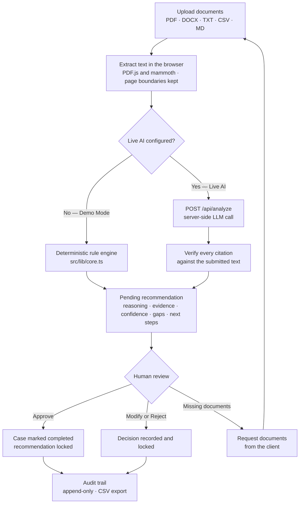
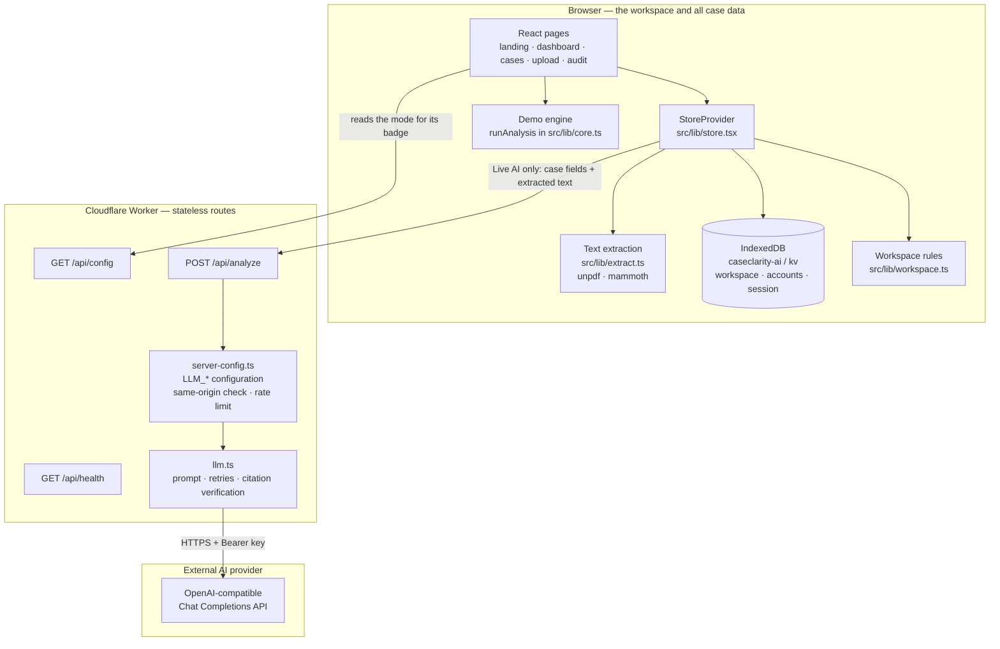

<div align="center">

# CaseClarity AI

**AI does the reading. Humans make the decisions. Every recommendation is traceable to evidence.**

An explainable, human-in-the-loop case preparation workspace for legal-aid nonprofits —
eviction defences, benefits appeals, employment claims and immigration filings.

Built by **Team HACKSMITHS** for **HACKSMITHS — Build for Campus 2026**

[](https://caseclarity-ai.eayub006.workers.dev)
[](https://github.com/eayub006-source/caseclarity-ai/actions/workflows/ci.yml)
[](https://github.com/eayub006-source/caseclarity-ai/tree/main/tests)
[](#license)

[](https://nextjs.org)
[](https://react.dev)
[](https://www.typescriptlang.org)
[](https://tailwindcss.com)
[](https://developers.cloudflare.com/workers/)
[](https://vitest.dev)

[Live demo](https://caseclarity-ai.eayub006.workers.dev) ·
[Repository](https://github.com/eayub006-source/caseclarity-ai) ·
[Demo guide](#product-demonstration) ·
[Architecture](#architecture) ·
[Run locally](#local-setup)

</div>

> **Prototype notice.** CaseClarity AI is a hackathon prototype, not legal advice and not a replacement
> for a qualified legal professional. Every case, client, document and metric in the demo is fictional.
> Confidence scores are uncalibrated heuristics, not probabilities.

---

## Contents

1. [The problem](#the-problem)
2. [Our solution](#our-solution)
3. [Key features](#key-features)
4. [How it works](#how-it-works)
5. [Product demonstration](#product-demonstration)
6. [Technology stack](#technology-stack)
7. [Architecture](#architecture)
8. [Data storage](#data-storage)
9. [API reference](#api-reference)
10. [Local setup](#local-setup)
11. [Environment variables](#environment-variables)
12. [Testing and code quality](#testing-and-code-quality)
13. [Security, privacy and responsible AI](#security-privacy-and-responsible-ai)
14. [Limitations and future work](#limitations-and-future-work)
15. [Project structure](#project-structure)
16. [Documentation](#documentation)
17. [License](#license)

---

## The problem

A caseworker at a small legal-aid nonprofit typically holds a pile of documents that arrived by email,
scan and post: a lease, a 14-day notice, three pay stubs, an emergency-room bill, a rent ledger.
A benefit denial letter, a termination letter, an email thread with HR, a custody order. The client's
deadline is days away.

The work is real, but it is dominated by manual reading:

- **High document volume.** Facts that decide a case are scattered across dozens of pages in
  incompatible formats, and every case starts the reading from zero.
- **Conflicting information.** Two pay figures disagree; a "position elimination" was followed by a
  job posting. These contradictions are exactly the facts that matter, and they are easy to miss.
- **Missing evidence.** Appeals are lost because one required document was never collected, and the
  gap is only discovered at filing time.
- **Manual, undocumented preparation.** Reasoning lives in a caseworker's head or in a scratch note,
  so nobody can review how a conclusion was reached.
- **Generic AI tools are not usable here.** A chat model that answers "what should I do?" produces
  text with no source, no page, no way to audit the claim, and no record of who approved it. For
  legal aid, an unverifiable recommendation is worse than no recommendation.

The cost of these problems is borne by people who cannot afford to lose: a family facing eviction,
a client whose benefits were cut off, a worker who was dismissed after requesting an accommodation.

## Our solution

CaseClarity AI turns a case file into **source-cited facts, explicit gaps and one explainable
recommendation** — then stops and hands the decision to a human.

| Principle | How the product enforces it |
|---|---|
| Evidence-backed fact extraction | Every fact carries its document name, page number, a verbatim snippet and a confidence value |
| Page-level citations | PDFs are read page by page, so "rent is $1,450" points at the page where it says so |
| Citation verification | On the Live AI path, every fact, evidence item and contradiction side is matched against the text that was actually submitted; mismatches are marked **Unverified** |
| Contradiction detection | Conflicts are stored as structured records with **at least two independently traceable sides**; a conflict that cannot cite two sides is dropped, not shown |
| Missing-document identification | A required-document checklist per case type, matched on file name *and* content, produces a completeness score |
| Explainable recommendations | Reasoning, evidence, confidence, missing information, uncertainties and numbered next steps — every time |
| Human approval and review | New recommendations are always `pending`; only a signed-in person can approve, modify or reject one, and the decision is locked afterwards |
| Append-only audit trail | Uploads, analyses, imports, exports, reviews, deletions and resets are recorded with actor, category and timestamp |

**The loop is deliberately narrow.** The system never states a legal conclusion, never marks its own
work as approved, and never hides a gap. When the documents do not support a conclusion, the Live AI
path requires the model to say so, and the recommendation is labelled as insufficiently evidenced.

## Key features

### Implemented features

| Area | What actually works |
|---|---|
| **Case management** | Create, list, search (title, client, case number), filter (status, case type) and delete cases (senior roles only). Case numbers are assigned as `CC-<year>-<NNN>`. Deleting a case removes its documents, facts and recommendations but keeps its audit history and records a deletion entry. |
| **Document upload and extraction** | PDF (real per-page text via PDF.js/`unpdf`), DOCX (`mammoth`), TXT, CSV and MD. 10 MB per file. Extraction runs **in the browser**; only extracted text is kept. |
| **Fact extraction** | The demo engine labels dates by nearby context (deadline, effective date, date of birth…), labels amounts by the closest keyword (rent, income, arrears, bill, debt…), annualises income when a period is given, and records document, page and snippet for each fact. |
| **Citation verification** | Server-side for Live AI: unknown documents, quotes not found in the text, and contradictions with fewer than two verified sides are handled explicitly (see [guardrails](#live-ai-guardrails)). |
| **Contradiction detection** | Different annual incomes, different monthly rents, and a "position eliminated / refilled" timeline conflict. Each side keeps its own document, page and quoted snippet. |
| **Missing-document detection** | Required-document checklist per case type with synonym matching (`Pay_Stubs_Mar2026.pdf` satisfies *Proof of Income*), a completeness percentage, and a checklist panel on the case. |
| **AI recommendations** | One pending recommendation per analysis with reasoning, cited evidence, contradictions, missing information, uncertainties, next steps and engine label. Re-running analysis replaces the case's facts and adds a new recommendation. |
| **Human review workflow** | Approve (marks the case completed), modify (requires replacement text, keeps the AI's original evidence), reject, add a comment, request documents, or flag for investigation. Approved and rejected recommendations are locked. |
| **Audit trail** | Per-case timeline and a global searchable timeline with category filters; CSV export. Records actor, action, details, category and timestamp. |
| **AI document summaries** | On the Live AI path, a short summary plus cited highlights per document, displayed on the case's Documents tab and stored in the visitor's browser. |
| **CSV import and export** | RFC 4180 parsing (PapaParse), tolerant column mapping, mixed-date handling, duplicate detection (client + title), an import report, a downloadable sample CSV, and export of cases and audit events. |
| **Demo Mode and Live AI** | Both paths exist and are labelled everywhere (mode badge, per-recommendation engine badge, audit wording). Demo Mode needs no API key and makes no provider call. |
| **Roles** | `case_worker`, `senior_case_worker` and `admin`; only the last two can delete cases or reset demo data. |
| **Cloudflare deployment** | Builds and serves the app plus three stateless API routes from a Cloudflare Worker via `vinext`. |

### Simulated or illustrative features

These are **not** working integrations or measured results, and the interface says so:

| Feature | Reality |
|---|---|
| **Google Drive import** | Simulated. Five fictional file rows, a case picker and placeholder text stored as `Google Drive (simulated)`. No OAuth, no Drive API, no real file content. |
| **Evaluation metrics** | Illustrative placeholders defined in `EVALUATION` (`src/lib/core.ts`) and labelled as such on the Evaluation page. No user study, benchmark or accuracy measurement has been run. The workspace totals on that page *are* live counts. |
| **Confidence scores** | Uncalibrated heuristics in both modes. The UI labels them as heuristic-only. |
| **Demo accounts** | Public by design (password shown on the sign-in page) and stored in the browser. They identify who did what in the audit trail; they are not an authentication boundary. |
| **Demo dataset** | Fictional cases, documents, facts, recommendations and audit history, seeded from `src/data/demo-data.ts`. |

### Not implemented

OCR for scanned PDFs · legacy `.doc` files · real page boundaries for DOCX · keeping the original
uploaded files · a shared workspace across devices or team members · password reset · organisation
administration · real Google Drive OAuth · server-enforced audit immutability · committed end-to-end
browser tests · measured evaluation results.

## How it works



1. **Upload** — drag and drop (or browse) into a case. The file is read in the browser; the original
   file is never uploaded or stored.
2. **Extract** — text is extracted page by page. PDFs keep real page numbers; DOCX/TXT/CSV/MD are split
   into estimated pages at paragraph boundaries, and the UI says which is which.
3. **Analyse** — *Run AI Analysis* extracts facts, checks the case type's required-document checklist and
   looks for contradictions, using either the demo engine or the configured LLM.
4. **Verify** — on the Live AI path the server matches every citation against the submitted text before
   anything is saved.
5. **Recommend** — a `pending` recommendation is stored with its evidence, gaps, doubts and next steps.
6. **Human review** — a signed-in caseworker approves, modifies, rejects, requests documents or flags the
   case. Approving marks the case completed.
7. **Audit** — every step above is appended to the audit trail with the actor and a timestamp.

### Demo Mode versus Live AI

| | Demo Mode | Live AI |
|---|---|---|
| Enabled when | `LLM_API_KEY` is empty, the provider fails, returns invalid JSON, times out, or its output fails validation | `LLM_API_KEY` is set and the provider responds with usable structured JSON |
| Where it runs | Entirely in the browser (`runAnalysis()` in `src/lib/core.ts`) | `POST /api/analyze` on the server, calling an OpenAI-compatible Chat Completions API |
| Network traffic | No outbound request for the analysis itself (the app still makes a same-origin `GET /api/config` to label the UI) | Case title, client name, case type and the extracted text of that case's documents (trimmed to a 60,000-character prompt budget), posted to `/api/analyze` |
| Output | Rule-based facts, checklist gaps, comparable-value contradictions, heuristic recommendation | Structured JSON from the model: facts, contradictions, missing items, document summaries, recommendation — all citation-checked server-side |
| Labelling | "Demo Mode" badge, `Demo engine` badge on the recommendation, audit entry `AI analysis completed (Demo Mode)` | "Live AI (model)" badge, `Live AI` badge, audit entry naming the model (and naming the primary model when a fallback answered) |
| Fallback behaviour | — | Any provider or validation failure returns `mode: "demo"` with a human-readable reason; the browser then runs the demo engine and the audit records why |

### Live AI guardrails

These are the checks in `src/lib/llm.ts` and `src/app/api/analyze/route.ts`, not prompt suggestions:

- **Verbatim citations only.** Documents are delimited by `=== DOCUMENT: name ===` and pages by
  `--- PAGE n ---`; the model must quote text and name a real file.
- **Server-side verification.** Unknown file names, quotes that do not appear in the text, and wrong page
  numbers are resolved against the submitted documents. Unverifiable facts are marked `verified: false`
  with confidence capped at 40, and the UI shows an **Unverified** badge.
- **Contradictions need two sides.** A contradiction with fewer than two verified sides is dropped.
- **Insufficient evidence is explicit.** If the model sets `sufficientEvidence: false`, confidence is
  capped at 60 and an uncertainty is added.
- **Bounded output.** At most 100 facts, 20 evidence items, 10 contradictions and 50 document summaries
  are accepted per response.
- **Bounded retries.** Transient faults (429, 500, 502, 503, 504, timeouts, network errors) are retried
  with exponential backoff and jitter; a 404 skips to the fallback model; **401/403 are never retried**
  because every model uses the same key.
- **No key leakage.** Provider error bodies are never copied into messages, because they can echo part of
  the API key and those messages are visible in the audit trail.
- **Safe degradation.** Timeouts, HTTP errors, unparseable JSON and rejected output all return
  `mode: "demo"` with a reason instead of an error page.

## Product demonstration

**Live demo:** <https://caseclarity-ai.eayub006.workers.dev>

### Demo credentials

| Name | Email | Password | Role |
|---|---|---|---|
| Alex Rivera | `demo@caseclarity.ai` | `demo1234` | Senior Case Worker |
| Jordan Lee | `caseworker@caseclarity.ai` | `demo1234` | Case Worker |

Both accounts belong to the fictional organisation *Northside Legal Aid*. The sign-in page also offers
one-click buttons for each account, and new accounts can be created on `/signup` (stored in that browser
with a bcrypt hash).

### Roles and permissions

| Capability | Case Worker | Senior Case Worker / Admin |
|---|---|---|
| Open cases, upload documents, run analysis | Yes | Yes |
| Approve, modify or reject recommendations | Yes | Yes |
| Request documents, flag a case for investigation | Yes | Yes |
| Delete a case (two-click confirmation) | No | Yes |
| Reset the workspace to the demo dataset | No | Yes |

Roles are enforced in the client-side store (`src/lib/store.tsx`) and reflected in the UI; they are not a
server-side authorisation boundary — see [Security](#security-privacy-and-responsible-ai).

### A three-minute walkthrough

| Time | Where | What to notice |
|---|---|---|
| 0:00–0:20 | Landing page `/` | The product statement and the honest scope: fictional data, not legal advice |
| 0:20–0:40 | `/login` | One-click sign-in as **Alex Rivera** (Senior Case Worker) |
| 0:40–1:05 | `/dashboard` | Live counts, cases by status, the pending-review queue and the AI-mode badge |
| 1:05–1:40 | Case `CC-2026-003` → **Analysis** tab | Facts with document, page, confidence and snippet; the `$62,000` vs `$69,600` contradiction shown with both sides cited |
| 1:40–2:10 | **Recommendation** tab | Reasoning, evidence, confidence labelled uncalibrated, missing information, uncertainties, next steps |
| 2:10–2:35 | **Human Review** panel | Approve with a comment, then open the **Audit** tab: the decision is recorded under your name and the recommendation is locked |
| 2:35–3:00 | Case `CC-2026-002` → **Overview**, then `/integrations` | The four missing documents for a SNAP appeal; CSV import/export beside the clearly labelled **Simulated** Google Drive |

### Screens worth opening

- **`/cases` → `CC-2026-002`**: missing-document handling, a case status of *Missing documents*, and four
  gaps on the required-documents checklist.
- **`/cases` → `CC-2026-001`**: a complete file at 100% completeness with a superseded/sample recommendation.
- **`/upload`**: real browser-side extraction, with per-file status and warnings for scanned PDFs.
- **`/audit`**: the global timeline, search, category filters and CSV export.
- **`/evaluation`**: the illustrative metrics, plainly labelled, next to live workspace totals.
- **`/integrations`**: the honesty line — "Google Drive is simulated; CSV import/export is real".

## Technology stack

Versions are taken from `package.json` and the build configuration.

| Layer | Technology | Version |
|---|---|---|
| Framework | Next.js (App Router, React Server Components) | 16.4.6 |
| UI | React / React DOM, all workspace pages are client components | 19.3.1 |
| Language | TypeScript (strict) | 5.9.3 |
| Styling | Tailwind CSS v4 with `@tailwindcss/postcss` | 4.1.17 |
| Icons | lucide-react | ^1.73.0 |
| Browser storage | IndexedDB, no wrapper library (`src/lib/browser-db.ts`) | Web API |
| PDF extraction | `unpdf` (Mozilla PDF.js) | ^1.9.1 |
| DOCX extraction | `mammoth` browser build | ^1.13.0 |
| CSV | `papaparse` | ^5.7.1 |
| Password hashing | `bcryptjs` (bcrypt, cost 10) | ^3.0.3 |
| Hosting | Cloudflare Workers via `vinext` + `@cloudflare/vite-plugin` + Vite | 1.4.6 / 2.0.0-rc.3 / 8.3.8 |
| Cloudflare CLI | `cf` (used by `@vinext/cloudflare`) | 1.0.0-rc.2 |
| Tests | Vitest | ^5.1.0 |
| Linting | ESLint 9 with `eslint-config-next` (`core-web-vitals`) | 9.39.4 / 16.4.6 |
| AI integration | Any OpenAI-compatible Chat Completions API, called with `fetch` (no SDK) | — |
| CI | GitHub Actions (Node 22) | — |

There is **no ORM, no SQL client and no database driver** in this version. Node.js 22 or newer is
required for tooling (CI pins Node 22; the `cf` CLI warns below 22.23.0).

## Architecture



**Two hard boundaries define the design.**

1. **Case data never leaves the browser.** There is no database and no server-side session. The workspace
   — cases, documents, extracted text, facts, recommendations, summaries, accounts and audit entries —
   lives in the visitor's IndexedDB. The backend rules a server would normally enforce (validation, case
   numbering, locked reviews, append-only audit) are implemented as pure, unit-tested functions in
   `src/lib/workspace.ts`, and `src/lib/store.tsx` is the only mutation gateway.
2. **The server is a stateless analysis service.** The Worker serves the app and exactly three JSON
   routes. It holds the API key, builds the prompt, calls the provider, verifies citations and returns
   JSON. It persists nothing and keeps no copy of a visitor's workspace.

That separation is what makes the demo safe to publish: opening the site gives you your own private
sandbox, no other visitor can see it, and the server retains nothing after the response.

The single documented exception to "data stays local" is Live AI: when a key is configured, the extracted
text of the case being analysed is sent to `/api/analyze` and on to the configured AI provider for that
one request.

## Data storage

| Data | Where it lives | Detail |
|---|---|---|
| Original uploaded files | **Nowhere** | Read into memory in the browser for text extraction, then discarded. Files are never uploaded and never persisted. |
| Documents and extracted text | **Browser IndexedDB** | Key `workspace` → `docs[]`. Pages are joined with `\f` so page numbers survive. |
| Facts and extractions | **Browser IndexedDB** | `workspace.extractions[]` — documentId, source document, page, snippet, confidence, category, `verified`. |
| Recommendations and review decisions | **Browser IndexedDB** | `workspace.recs[]` — evidence, contradictions, status, reviewer, comment, engine. |
| AI document summaries and highlights | **Browser IndexedDB** | `workspace.summaries[]`, written only by the Live AI path. |
| Audit trail | **Browser IndexedDB** | `workspace.audit[]`, newest first; deletions keep history and unlink the case. |
| Local accounts | **Browser IndexedDB** | Key `accounts` — email, role, org and a bcrypt hash. The password is never stored. |
| Signed-in session | **Browser IndexedDB** | Key `session` → `{ userId }`. |
| Server-side data | **None** | Route handlers are stateless and keep nothing between requests. |
| Relational database | **None in this version** | No Cloudflare D1 binding, no `db/` schema, no PostgreSQL, no migrations. |

**Implementation notes** (`src/lib/browser-db.ts`, `src/lib/workspace.ts`):

- Single IndexedDB database `caseclarity-ai` with one object store, `kv`; the workspace is versioned
  (`WORKSPACE_VERSION = 2`) and an older or unreadable copy is replaced by the seeded demo dataset.
- Every storage call resolves instead of throwing. In a private window or with site data blocked, the app
  keeps working in memory and warns that changes will be lost on reload.
- *Reset demo data* (senior caseworkers only) restores `src/data/demo-data.ts` and appends a
  `Demo data reset` audit entry.
- Each browser profile and device has its own workspace. Clearing site data starts again from the demo
  data. Two open tabs each save their own copy; the last write wins.
- The workspace is **not partitioned per account**: every account used in the same browser sees the same
  cases and audit trail. Sign-in decides who is recorded as the actor, not which data you can see.
- First visit seeds the fictional dataset: 6 cases, 19 documents, 20 curated facts, 6 sample
  recommendations and 14 audit events.

Live AI summaries are therefore private to the visitor who generated them. There is no D1 database and
no `/api/summaries` route in this codebase: if you are looking for a server-side summaries store, it does
not exist here.

## API reference

Three stateless routes, all under `src/app/api/`. All responses are JSON. No endpoint stores anything.

| Method | Endpoint | Purpose |
|---|---|---|
| `GET` | `/api/health` | Liveness probe |
| `GET` | `/api/config` | Non-secret runtime flags so the UI can label itself honestly |
| `POST` | `/api/analyze` | Live AI analysis of a case's extracted text, with citation verification |

### `GET /api/health`

Returns `200` with `{"ok": true}`. There is no database to check.

### `GET /api/config`

Returns the active AI mode:

```json
{ "aiMode": "demo", "model": null }
```

`aiMode` is `"llm"` when `LLM_API_KEY` is configured, otherwise `"demo"`; `model` is the configured
model name in Live AI mode and `null` in Demo Mode. No secret is ever included.

### `POST /api/analyze`

**Request**

```json
{
  "case": { "title": "Eviction Defense", "clientName": "Maria Gonzalez", "caseType": "Housing / Eviction" },
  "documents": [{ "id": "doc-1", "name": "Lease_Agreement.txt", "extractedText": "..." }]
}
```

The browser trims documents to a 60,000-character prompt budget, sends at most 50 documents, and sends
only the case fields listed above — never the workspace, the audit trail or the accounts.

**Response — Live AI (`200`)**

```json
{
  "mode": "llm",
  "model": "gemini-3.8-flash",
  "primaryModel": "gemini-3.8-flash",
  "fallbackUsed": false,
  "attempts": 1,
  "result": {
    "facts": [],
    "contradictions": [],
    "missing": [],
    "documentSummaries": [],
    "recommendation": {},
    "unverifiedCount": 0
  }
}
```

`model` is the model that actually answered; `primaryModel` is always the configured primary, so the
audit trail can show when a fallback stood in.

**Response — fallback (`200`)**

```json
{ "mode": "demo", "reason": "No LLM_API_KEY configured — using the local demo engine." }
```

Returned when no key is configured, when the provider errors or times out, when the response is not
valid JSON, or when the output fails validation. The browser then runs its local demo engine, and the
audit entry names the reason.

**Errors**

| Status | When | Body |
|---|---|---|
| `400` | No usable document in the request | `{"error": "Upload at least one document first"}` |
| `403` | Cross-site browser request (Origin or `Sec-Fetch-Site` mismatch) | `{"error": "Cross-site request blocked"}` |
| `413` | Declared body over ~1.2 MB, or documents whose text exceeds 600,000 characters | `{"error": "Request too large"}` / `{"error": "Documents are too large to analyze"}` |
| `429` | More than 10 Live AI analyses per minute for one visitor | `{"error": "Too many AI analyses..."}` with `Retry-After: 60` |

**Access control.** The route blocks cross-site browser requests (a CSRF guard), and on Cloudflare a
rate-limit binding caps each visitor at 10 Live AI analyses per minute. There is no user authentication
on the API: anyone who can open the deployment can call it, which is why a spending cap on the provider
key is recommended. Locally the limiter is absent and requests are allowed.

**Configuration.** Request timeouts, transient-fault retries and a fallback model chain are handled in
`postChatCompletion()`; see [Environment variables](#environment-variables).

## Local setup

### Prerequisites

- **Node.js 22 or newer** (CI uses Node 22; `cf` warns below 22.23.0) and npm 10+
- Git
- No database, no Docker and no API key are required — the app starts in Demo Mode

### Steps

```bash
# 1. Clone
git clone https://github.com/eayub006-source/caseclarity-ai.git
cd caseclarity-ai

# 2. Install dependencies
npm ci           # or: npm install

# 3. Optional configuration (Demo Mode works without it)
cp .env.example .env

# 4. Start the Next.js dev server
npm run dev      # http://localhost:3000

# 5. Run the checks (all offline)
npm test
npm run typecheck
npm run lint
```

Open <http://localhost:3000>, go to **Try the demo**, and click one of the one-click demo accounts — or
sign in with `demo@caseclarity.ai` / `demo1234`. The workspace is seeded with six fictional cases on
first visit and saved in that browser.

### Working with the Cloudflare build

```bash
npm run dev:cloudflare      # vinext dev server on port 3001, using the Workers runtime
npm run build:cloudflare    # build the Worker (what gets deployed)
npm run preview:cloudflare  # run the built Worker locally with Vite preview
```

For the local Worker preview, copy `.dev.vars.example` to `.dev.vars` (gitignored) if you want Live AI;
leave `LLM_API_KEY` empty to stay in Demo Mode.

### Deploying to Cloudflare

Deployment is **manual, never on push**. Two supported paths:

```bash
# From your machine: authenticate once, then deploy the existing Worker
npx cf auth login
npm run deploy
```

or dispatch the **Deploy to Cloudflare Workers** workflow (`workflow_dispatch`) with an optional git ref
and a `stage-only` toggle. The workflow:

1. checks out the requested ref,
2. runs `npm test`, `npm run typecheck` and `npm run lint` as a gate,
3. fails fast if `CLOUDFLARE_API_TOKEN`, `CLOUDFLARE_ACCOUNT_ID` or `LLM_API_KEY` is missing,
4. writes the `LLM_*` Worker secrets, lists them to confirm the write, then deploys.

The Worker is updated in place under the name `caseclarity-ai`; re-dispatching with an earlier commit SHA
rolls back. A declared secret is required at deploy time, so a Worker can never silently deploy without
the AI configuration it expects. Demo Mode is unaffected by any provider failure.

### Scripts

| Command | What it does |
|---|---|
| `npm run dev` | Next.js development server on port 3000 |
| `npm run build` / `npm start` | Next.js production build / server |
| `npm run dev:cloudflare` | vinext dev server on port 3001 with the Workers runtime |
| `npm run build:cloudflare` | Build the Cloudflare Worker |
| `npm run preview:cloudflare` | Serve the built Worker locally |
| `npm run deploy` | Build and deploy to the existing Cloudflare Worker |
| `npm test` | Vitest unit test suite |
| `npm run typecheck` | `next typegen && tsc --noEmit` |
| `npm run lint` | ESLint over the repository |

> `npm run build` fetches the Geist font from Google Fonts at build time through `next/font`, so that one
> command needs outbound network access. The Cloudflare build does not.

## Environment variables

Every variable is optional. With none of them set, the app runs in Demo Mode.

| Variable | Default | Required | Purpose |
|---|---|---|---|
| `LLM_API_KEY` | *(empty)* | No — only for Live AI | Enables Live AI. A Google key starts with `AIza`. |
| `LLM_BASE_URL` | `https://api.openai.com/v1`, or Google's OpenAI-compatible endpoint when a Google key is detected and this is unset or still points at OpenAI | No | Base URL of an OpenAI-compatible API (the code appends `/chat/completions`) |
| `LLM_MODEL` | `gpt-4o-mini`, or `gemini-3.8-flash` when a Google key is detected and this is unset or looks like an OpenAI model | No | Model name sent to the provider |
| `LLM_TIMEOUT_MS` | `90000` | No | Provider request timeout in milliseconds, clamped to 5,000–300,000 |
| `LLM_FALLBACK_MODELS` | `gemini-3.5-flash-lite` | No | Comma-separated fallback models, tried in order when the primary is unavailable |
| `LLM_MAX_ATTEMPTS` | `3` | No | Total HTTP attempts shared across the model chain, clamped to 1–5 |
| `LLM_RETRY_BASE_DELAY_MS` | `1000` | No | Base delay for exponential backoff, clamped to 0–30,000 ms |

### How the values are resolved

- A key beginning with `AIza` is treated as a Google key. If `LLM_BASE_URL` is missing or still set to
  `api.openai.com`, the Google endpoint is used, and an OpenAI-style model name is replaced by
  `gemini-3.8-flash`. This prevents the "Incorrect API key provided" failure caused by sending a Gemini
  key to OpenAI.
- Timeout, attempt budget and backoff are clamped, so a bad value cannot produce an unbounded wait.

### Configuring Gemini

```dotenv
LLM_API_KEY=AIza...your-key...
# Optional — detected automatically for a Google key:
# LLM_BASE_URL=https://generativelanguage.googleapis.com/v1beta/openai/
# LLM_MODEL=gemini-3.8-flash
```

### Configuring another OpenAI-compatible provider

```dotenv
LLM_API_KEY=your-provider-key
LLM_BASE_URL=https://your-provider.example/v1
LLM_MODEL=your-model-name
LLM_TIMEOUT_MS=90000
LLM_FALLBACK_MODELS=
```

### Where each runtime reads them

| Runtime | Source |
|---|---|
| `npm run dev` (Next.js) | `.env` (copy `.env.example`) |
| Local Worker preview | `.dev.vars` (copy `.dev.vars.example`) |
| Deployed Worker | Worker secrets. `LLM_API_KEY`, `LLM_BASE_URL`, `LLM_MODEL` and `LLM_TIMEOUT_MS` are declared as secrets in `cloudflare.config.ts` and written by the deploy workflow; `LLM_FALLBACK_MODELS` is a plain-text binding. |

The retry knobs (`LLM_MAX_ATTEMPTS`, `LLM_RETRY_BASE_DELAY_MS`) are not declared bindings on the Worker,
so the deployed defaults apply there unless you add them to `cloudflare.config.ts`.

**Never commit `.env` or `.dev.vars`** — both are gitignored. The key is read server-side only
(`src/lib/server-config.ts`, the only file that reads `process.env`); nothing sensitive uses
`NEXT_PUBLIC_*`, and the browser learns only the mode and the model name from `GET /api/config`.

### What is actually deployed

The repository supports several configurations, so be precise about which one is which:

| | Value | Source of truth |
|---|---|---|
| **Intended deployment configuration** | Google Gemini `gemini-3.8-flash` via `https://generativelanguage.googleapis.com/v1beta/openai/`, 90 s timeout | `.github/workflows/deploy-cloudflare.yml` |
| **Code default when no `LLM_*` variables are set** | `gpt-4o-mini` at `https://api.openai.com/v1` | `src/lib/server-config.ts`, `.env.example` |
| **Actual production runtime** | Not determinable from the repository. `GET /api/config` on the deployment reports the live mode and model; check it rather than assuming Gemini is active. | — |

## Testing and code quality

**Verified on 2026-11-21** against commit `4648561`:
`npm test` → **112/112 passing in 11 files**; `npm run typecheck` → pass; `npm run lint` → pass;
`npm run build:cloudflare` → pass. The latest CI runs on `main` are green.

`npm run build` was not executed in that verification environment because it fetches the Geist font from
Google Fonts; CI runs it on every push.

### The suite

| File | Tests | Covers |
|---|---:|---|
| `tests/llm.test.ts` | 31 | Prompt shape, citation verification, page correction, unknown documents, contradiction sides, insufficient evidence, provider failures, retries and fallback |
| `tests/analyze-route.test.ts` | 15 | `POST /api/analyze` end to end: demo fallback without a key, 403/400/413, verified and unverified citations, HTTP 429/500, invalid JSON, rejected output, timeout, network failure |
| `tests/workspace.test.ts` | 14 | Demo dataset integrity, workspace loading, case numbering and validation, cascade delete keeping audit history, CSV dedupe, pending-only recommendations, locked reviews, fact replacement |
| `tests/analysis.test.ts` | 12 | Required-document checklist and synonym matching, demo engine output, labelled amounts, contradiction rules |
| `tests/server-config.test.ts` | 8 | Google-key routing, timeout clamping, retry configuration, error messages free of key text, per-visitor rate limiting |
| `tests/misc.test.ts` | 7 | Roles, date normalisation, estimated pagination |
| `tests/workflow.test.ts` | 7 | Analysis → cited facts → pending recommendation → human review → audit trail, through the store rules |
| `tests/extraction.test.ts` | 6 | Real PDF and DOCX extraction through the browser code path, page attribution |
| `tests/accounts.test.ts` | 4 | Demo sign-in, wrong passwords, bcrypt-hashed sign-ups, duplicate and invalid accounts |
| `tests/auth.test.ts` | 4 | bcrypt hashing and salting |
| `tests/csv.test.ts` | 4 | CSV parsing, export quoting, duplicate detection |
| **Total** | **112** | No network, database or API key needed |

### Quality gates

```bash
npm test                  # 112 unit tests
npm run typecheck         # next typegen + tsc --noEmit
npm run lint              # ESLint (next/core-web-vitals)
npm run build             # Next.js production build
npm run build:cloudflare  # Cloudflare Worker build (what is deployed)
```

`.github/workflows/ci.yml` runs all five on every push and pull request on Node 22, with
`NEXT_TELEMETRY_DISABLED=1`.

### Testing the Live AI path without a real key

A mock OpenAI-compatible provider and a 14-scenario runner are included:

```bash
node tests/mock-openai-server.mjs 4010     # terminal 1 — mock provider
cp tests/mock-llm.env.example .env         # point the app at it (gitignored)
npm run dev                                # terminal 2
node tests/e2e-live-ai.mjs                 # terminal 3 — prints PASS/FAIL per scenario
```

The mock is a test double, not a model. Its scenarios cover verified and unverified citations,
contradictions as well as consistent documents, unsupported conclusions, malformed JSON, HTTP 401/429/500,
a transient 503 that recovers on retry, a persistent 503 that exhausts the fallback chain, and a timeout.
Live AI has **not** been validated against a real provider from the development environment; verify it
with your own key before relying on it.

## Security, privacy and responsible AI

### Privacy

- **Original files are processed in the browser** (`unpdf`/PDF.js and `mammoth`), never uploaded.
- **Only extracted text is kept**, in the visitor's own IndexedDB.
- **Extracted text leaves the browser only for Live AI**, when a key is configured: the case's document
  text goes to `/api/analyze` and then to the configured provider for that request. In Demo Mode no
  document text or case data leaves the browser.
- **API keys stay server-side.** `src/lib/server-config.ts` is the only place `process.env` is read;
  provider error bodies are never echoed, because they can contain fragments of the key.
- **Case data is browser-local.** There is no server-side session, no shared workspace and no database.
- **No real client data should be uploaded.** The demo accounts, cases, documents and metrics are
  fictional; the sign-up screen repeats this warning.

### Authentication and access

- Accounts are a **demo convenience**, not production authentication. They live in the browser, anyone
  with access to that browser profile can read its storage, and there is no server to enforce identity.
  Sign-in exists so the audit trail can attribute actions to a person.
- The API has **no user authentication**. `/api/analyze` is protected by a same-origin check and, on
  Cloudflare, a 10-per-minute-per-visitor rate limit. A public deployment with a real key should sit
  behind Cloudflare Access or a spending cap.
- The audit trail is append-only **by application convention** (`appendAudit()` only prepends). It is not
  cryptographically sealed or server-enforced.

### Responsible AI

- **No final decisions.** Recommendations are advisory, always start `pending`, and are locked only by a
  human action. The system prompt forbids stating legal decisions, orders or conclusions of law.
- **Facts are separated from interpretation.** Quoted facts carry document, page and snippet; reasoning,
  uncertainties and next steps are labelled as generated.
- **Uncertainty is surfaced, not hidden.** Missing information, uncertainties, unverified citations and
  insufficient-evidence flags appear in the recommendation itself.
- **Confidence is not a probability.** It is an uncalibrated heuristic in both modes, and the UI says so.
- **Simulated features are labelled as simulated.** Google Drive, the evaluation figures, the demo
  dataset and the demo accounts are never presented as production functionality.
- **This is a prototype.** It is not legal advice, has not been reviewed by legal professionals for
  production use, and has no measured accuracy results.

## Limitations and future work

### Current limitations

| Area | Limitation |
|---|---|
| Persistence | Per browser and per device. No shared workspace, no cross-device access; clearing site data resets to the demo dataset. Two tabs can overwrite each other. |
| Identity | Browser-local accounts are not a security boundary; no password reset, no organisations, no admin console. |
| Live AI | Not validated against a real provider from the development environment; unprotected on a public deployment apart from the rate limit. |
| Extraction | No OCR, so scanned or image-only PDFs yield no text. No legacy `.doc`. Only PDFs have real page numbers; DOCX/TXT/CSV/MD pages are estimated at ~1,800 characters. |
| Data retention | Original files are deliberately not stored, so a fact cannot be re-read from the file inside the app; extracted text is what remains. |
| Demo engine | Simple, deterministic heuristics. Running an analysis on a seeded case can produce different text from its curated sample recommendation. |
| Audit | Append-only by convention only; not tamper-evident, and any browser storage can be cleared. |
| Evaluation | The metrics on `/evaluation` are illustrative placeholders. No user study or benchmark has been run. |
| Toolchain | vinext targets Next.js 16 without a full parity guarantee; `@cloudflare/vite-plugin` 2.0 and `cf` are release candidates. |
| Tests | Unit and route tests only. The scripted browser walkthrough is not committed to the repository. |

### Proposed work

| Priority | Item |
|---|---|
| Next | Add OCR (scanned PDFs, photos) and legacy `.doc` support; keep an optional encrypted copy of the original file |
| Next | Protect the public Live AI deployment (Cloudflare Access or an auth proxy) and add per-organisation quotas |
| Next | Run the timed caseworker study and extraction benchmark, then replace the placeholder evaluation numbers with measured results |
| Later | Shared workspace: server-side storage and sessions, with `src/lib/workspace.ts` reused as the rule layer (Cloudflare D1 or PostgreSQL) |
| Later | Real Google Drive integration (OAuth 2.0 + Drive API) and a CSV column-mapping step |
| Later | Commit the end-to-end browser walkthrough as Playwright tests in CI |
| Later | Server-enforced, tamper-evident audit log; content-based document classification; first-class contradiction records across analyses |

## Project structure

```text
caseclarity-ai/
├── .github/workflows/
│   ├── ci.yml                        # test · typecheck · lint · Next build · Cloudflare build
│   └── deploy-cloudflare.yml         # manual deploy, secret checks, gate on CI checks
├── src/
│   ├── app/
│   │   ├── (app)/                    # signed-in workspace (sidebar shell)
│   │   │   ├── audit/page.tsx        # global audit trail + CSV export
│   │   │   ├── cases/[id]/page.tsx   # case detail: six tabs, upload, analysis, review
│   │   │   ├── cases/new/page.tsx    # create a case
│   │   │   ├── cases/page.tsx        # list, search, filter, export
│   │   │   ├── dashboard/page.tsx    # counts, status chart, review queue
│   │   │   ├── evaluation/page.tsx   # illustrative metrics + live totals
│   │   │   ├── integrations/page.tsx # simulated Drive + real CSV import/export
│   │   │   ├── layout.tsx            # auth gate, navigation, AI-mode badge, reset
│   │   │   └── upload/page.tsx       # multi-file upload with per-file status
│   │   ├── api/analyze/route.ts      # POST — Live AI analysis, verification, rate limit
│   │   ├── api/config/route.ts       # GET  — aiMode and model (non-secret)
│   │   ├── api/health/route.ts       # GET  — liveness
│   │   ├── globals.css               # Tailwind theme tokens
│   │   ├── layout.tsx                # root layout + StoreProvider
│   │   ├── login/page.tsx            # one-click demo accounts
│   │   ├── page.tsx                  # landing page
│   │   └── signup/page.tsx           # local account creation
│   ├── components/ui.tsx             # shared badges, cards, banners, buttons
│   ├── data/demo-data.ts             # the fictional dataset (cases, docs, facts, audit)
│   ├── lib/                          # 12 modules: store, workspace, core, llm, extract, csv…
│   └── types/                        # ambient types for import.meta.env and mammoth
├── tests/                            # 11 Vitest files (112 tests) + mock provider + e2e script
├── cloudflare.config.ts              # Worker name, entrypoint, bindings, rate limit
├── vite.config.ts                    # vinext + Cloudflare plugin
├── vitest.config.ts                  # node environment, "@/" alias
├── next.config.ts
├── tsconfig.json
├── eslint.config.mjs
├── postcss.config.mjs
├── .env.example                      # optional LLM settings for `npm run dev`
├── .dev.vars.example                 # optional LLM settings for the Worker preview
├── package.json · package-lock.json
├── AGENTS.md · CONTEXT.md · PROBLEM_STATEMENT.md · PROJECT_STATUS.md
└── README.md
```

## Documentation

| Document | What it covers |
|---|---|
| [CONTEXT.md](./CONTEXT.md) | Full project context: feature status, data model, API, pipeline, limitations |
| [PROJECT_STATUS.md](./PROJECT_STATUS.md) | Plain-language summary of what is done and what remains |
| [PROBLEM_STATEMENT.md](./PROBLEM_STATEMENT.md) | The hackathon brief, the problem, the approach and success measures |
| [AGENTS.md](./AGENTS.md) | Working guide for developers and coding assistants: setup, conventions, safe-change rules |

These documents are useful context but were written at different times; where they disagree with the
code, the code is authoritative. For example, some of them still quote older test counts.

## License

**This repository contains no license file.** `package.json` declares no `license` field either, so the
default rules apply: the code is publicly readable, but no permission is granted to copy, modify or
redistribute it. Contact the authors (Team HACKSMITHS) if you want to reuse it.

All demo content — case names, clients, documents, recommendations, audit entries and evaluation
numbers — is fictional. CaseClarity AI is a hackathon prototype: it is not legal advice, must not be used
to make legal decisions, and must not be used with real client data in its current form.

---

<div align="center">

**CaseClarity AI** · Team HACKSMITHS · HACKSMITHS — Build for Campus 2026

*AI reads. People decide. Evidence proves it.*

</div>
